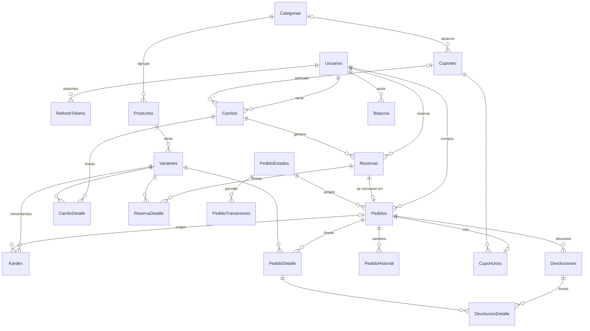
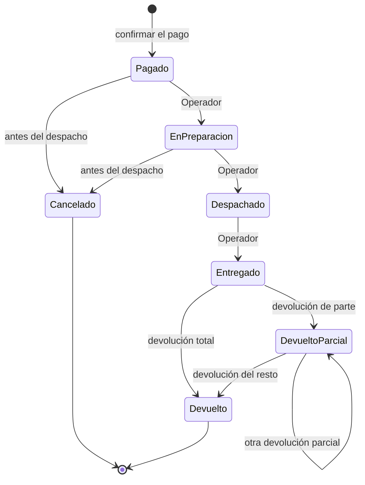
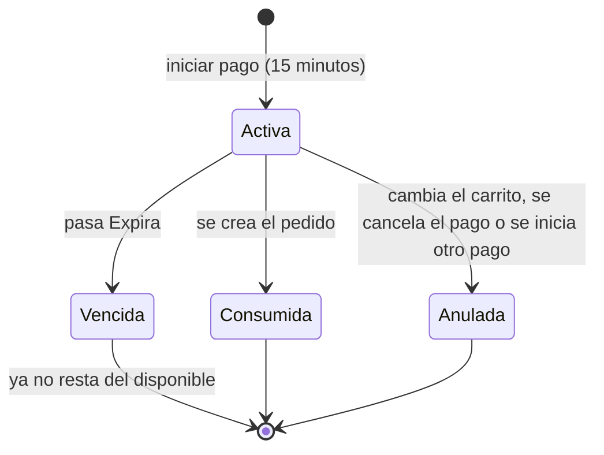

# ShopCart

Plataforma web de ventas con SQL Server, API en Express con TypeScript y frontend en React con TypeScript (Fase 2).
La especificación está en [docs/especificacion.md](docs/especificacion.md). Esta entrega (Fase 1) incluye la base de datos y el backend.

## Requisitos

- Docker con Docker Compose.
- Node.js 24 o superior, solo para desarrollar la API fuera de Docker.

## Instalación

```bash
git clone https://github.com/eramirez150/shopcart.git
cd shopcart
cp .env.example .env
```

Editar `.env` y definir estos tres valores, sin comillas. Si falta alguno, `docker compose` se detiene con un error.

| Variable | Descripción |
| --- | --- |
| `MSSQL_SA_PASSWORD` | Clave de `sa`: mínimo 8 caracteres con mayúsculas, minúsculas, números y símbolos |
| `APP_DB_PASSWORD` | Clave de `shopcart_app`, con las mismas reglas |
| `JWT_SECRET` | Al menos 32 caracteres aleatorios |

```bash
docker compose up --build
```

La API queda en `http://localhost:3000/api` y su documentación en `http://localhost:3000/api/docs`. La base de datos queda disponible solo desde la propia máquina en `127.0.0.1,14335`. Los scripts de `database/` se aplican en orden: tablas y semillas una sola vez; funciones, vistas, procedimientos y permisos en cada arranque.

### Usuario de la aplicación

La API no usa `sa`: usa `shopcart_app`, que solo tiene `EXECUTE` sobre los stored procedures por medio del rol `RolShopCartApp` (script `06_permisos/001_rol_aplicacion.sql`). `database/aplicar.sh` lo crea con la clave de `APP_DB_PASSWORD`.

### API fuera de Docker

```bash
cd api
npm install
```

Crear `api/.env` con estas variables (la API también las lee del entorno):

| Variable | Descripción | Por defecto |
| --- | --- | --- |
| `DB_HOST`, `DB_PORT`, `DB_NAME` | Dónde está la base | `127.0.0.1`, `14335`, `ShopCart` |
| `DB_USER`, `DB_PASSWORD` | Usuario de la aplicación (`shopcart_app`) | obligatorias |
| `JWT_SECRET` | Al menos 32 caracteres aleatorios. Generar con `node -e "console.log(require('crypto').randomBytes(48).toString('base64url'))"` | obligatoria |
| `JWT_ACCESS_MINUTES`, `JWT_REFRESH_DAYS` | Vida del token de acceso y del refresh token | `15`, `7` |
| `PORT`, `CORS_ORIGIN` | Puerto y orígenes permitidos separados por coma | `3000`, `http://localhost:5173` |

```bash
npm run dev      # desarrollo con recarga
npm run build && npm start
```

La documentación interactiva está en `http://localhost:3000/api/docs` (Swagger UI, con botón **Authorize** para pegar el JWT). El contrato escrito a mano es [api/openapi.yaml](api/openapi.yaml).

### Pruebas

```bash
cd api
npm run typecheck
npm test
```

`seguridad.test.ts` no necesita base de datos. `flujo.test.ts` y `concurrencia.test.ts` exigen una base **recién creada** con todos los scripts y una conexión (`DB_USER` y `DB_PASSWORD`, o `TEST_DB_CONNECTION_STRING` con el controlador `msnodesqlv8` para SQL Server LocalDB). Sin conexión se omiten. Crean y modifican datos: usar una base de pruebas.

Las pruebas de permisos del usuario de la aplicación están en `database/pruebas/permisos.sql` (`aplicar.sh` no ejecuta la carpeta `pruebas/`).

## Credenciales de prueba

Solo para desarrollo, creadas por los scripts de `database/02_semillas`. Cámbielas o elimínelas en cualquier entorno real.

| Rol | Correo | Contraseña |
| --- | --- | --- |
| Administrador | `admin@shopcart.test` | `Admin123!` |
| Operador | `operador@shopcart.test` | `Operador123!` |
| Cliente | `cliente@shopcart.test` | `Cliente123!` |
| Cliente | `cliente2@shopcart.test` | `Cliente123!` |

Cupones de ejemplo: `BIENVENIDA10` (10 %, una vez por cliente), `Q50` (Q50 con compra mínima de Q300), `ELECTRO15` (15 % solo en Electrónica), `LIMITADO5` (5 usos en total), `VENCIDO` e `INACTIVO` (para ver los rechazos).

## Scripts de base de datos

Cada objeto vive en su propio archivo y el archivo se llama como el objeto (`SP_Pedidos_Listar.sql`). `aplicar.sh` recorre las carpetas en orden numérico y, dentro de cada una, los archivos en orden alfabético.

```text
database/
  01_tablas/          Tablas, índices y triggers por módulo (001_usuarios, 002_catalogo, ...)
  02_semillas/        Datos de prueba: usuarios por rol, categorías, 50 productos, kardex y cupones
  03_funciones/       FU_Modulo_Proceso.sql
  04_vistas/          VW_Modulo_Proceso.sql
  05_procedimientos/  Una subcarpeta por módulo, con SP_Modulo_Proceso.sql
  06_permisos/        Rol de aplicación con solo EXECUTE
  pruebas/            Pruebas manuales; aplicar.sh no las ejecuta
  aplicar.sh
```

| Carpeta | Cómo se aplica |
| --- | --- |
| `01_tablas`, `02_semillas` | Una sola vez. Cada archivo se registra en `dbo.ScriptsAplicados` con su ruta relativa. |
| `03_funciones` a `06_permisos` | En cada ejecución, con `CREATE OR ALTER`. No se registran: un cambio en un SP llega a una base que ya existe. |

- Cada archivo se ejecuta en su propia transacción (en `01` y `02`, junto con su registro). Si algo falla, no queda nada a medias y el contenedor `db-init` termina con error.
- Un archivo no abre ni confirma transacciones propias.
- Las tablas no se pueden reaplicar: un cambio en una tabla ya creada exige un archivo nuevo en `01_tablas` (por ejemplo `010_cambio.sql` con `ALTER TABLE`), nunca editar el existente.
- Si una vista o función depende de otra, se les pone un prefijo numérico para que se creen en orden. Hoy ninguna lo necesita.

### Agregar un procedimiento

1. Crear `database/05_procedimientos/<Modulo>/SP_<Modulo>_<Proceso>.sql` con una sola instrucción `CREATE OR ALTER PROCEDURE dbo.SP_<Modulo>_<Proceso>` y `GO` al final.
2. Poner encima un comentario breve que explique qué hace.
3. Ejecutar `docker compose up db-init`: el archivo nuevo se aplica y los demás se reaplican sin cambios.

Una función se agrega igual en `03_funciones` y una vista en `04_vistas`. El módulo es la carpeta; los errores se lanzan con `THROW 52000 + código HTTP`.

### Vistas de control

Son de solo lectura, sirven para revisar desde SSMS y la API no las usa.

| Vista | Qué muestra |
| --- | --- |
| `VW_Inventario_Control` | Una fila por variante: existencia, reservado, disponible y la diferencia con la suma del kardex, que debe ser 0. |
| `VW_Pedidos_Resumen` | Una fila por pedido: cliente, estado, líneas, unidades, devoluciones, totales y cupón. |

```sql
SELECT * FROM dbo.VW_Inventario_Control WHERE DiferenciaKardex <> 0;
SELECT * FROM dbo.VW_Pedidos_Resumen ORDER BY FechaCreacion DESC;
```

### Reglas por módulo

- Un pedido completado es `Entregado` o `DevueltoParcial`; las ventas del dashboard son netas de devoluciones.
- Cualquier cambio en el carrito anula su reserva activa: el cliente debe iniciar el pago otra vez.
- Las escrituras del catálogo exigen rol Administrador y nada con ventas o movimientos se elimina: se desactiva.
- El hash de la contraseña lo calcula la API (bcrypt); del refresh token solo se guarda su SHA-256.
- Los errores usan `THROW` con `52000` más el código HTTP: `52400` datos inválidos, `52401` no autenticado, `52403` sin permiso, `52404` no existe y `52409` conflicto con el estado actual.

## Decisiones técnicas

| Riesgo | Decisión |
| --- | --- |
| Sobreventa | `SP_Checkout_IniciarPago` bloquea las variantes con `UPDLOCK, HOLDLOCK` en orden de `IDVariante` y compara contra el disponible. Una prueba lanza 25 compras simultáneas de 4 unidades y exactamente 4 pasan. |
| Reserva vencida | Disponible = existencia − reservas `Activa` con `Expira` futura (`FU_Inventario_Disponibilidad`). Sin proceso programado. Iniciar el pago otra vez anula la reserva anterior, vencida o no. |
| Precio congelado | `ReservaDetalle` guarda precio y descuento; `PedidoDetalle` los copia. |
| Pedido duplicado | `Pedidos.IDReserva` es `UNIQUE` y la fila de la reserva se bloquea: un reintento espera y devuelve el mismo pedido. |
| Cupón concurrente | `UPDATE Cupones SET Usos = Usos + 1 WHERE Usos < LimiteTotal` y revisión de `@@ROWCOUNT`; la misma transacción revisa el límite por cliente. |
| Descuento exacto | El descuento total se calcula una vez y se reparte por líneas con diferencias de sumas acumuladas redondeadas: las líneas suman exactamente el total y nunca superan su valor. |
| Datos de otro cliente | `@IDUsuario` sale del JWT. Además, los SP vuelven a verificar el rol y la propiedad. |
| Estados | Tabla `PedidoTransiciones`, validada en el servicio y en `SP_Pedidos_CambiarEstado`. |
| Existencia | Solo `SP_Inventario_RegistrarMovimiento` la cambia, junto con su fila de kardex en la misma transacción. |
| Bitácora | Triggers sobre productos, variantes, cupones y estado de pedidos, más un trigger `INSTEAD OF UPDATE, DELETE` que la hace inmutable. El SP guarda el usuario con `sp_set_session_context`. |
| Permisos | Rol `RolShopCartApp` con `EXECUTE` y nada más. Se verifica en `database/pruebas/permisos.sql`. |
| Errores | Los SP lanzan `THROW 52000 + código HTTP` (`52409` es 409). La API lo traduce en un solo lugar. |
| Sesiones | Access token de 15 minutos (token expirado: 401). Refresh token aleatorio de un solo uso: en la base solo se guarda su SHA-256; reusar uno revocado cierra todas las sesiones del usuario. Contraseñas con bcrypt (costo 10). |
| Venta neta | Un pedido completado es `Entregado` o `DevueltoParcial`. El dashboard descuenta las devoluciones y las fechas filtran por la del pedido. |
| Pago | Simulado: confirmar el pago crea el pedido con una referencia única. |

Limitaciones conocidas: un usuario desactivado conserva su token de acceso hasta que vence (15 minutos) y no puede renovarlo; no hay límite de intentos de inicio de sesión.

## Modelo entidad-relación



## Diagramas de estados

Pedido (las transiciones salen de `PedidoTransiciones`):



Reserva de existencia:



`Vencida` no es un valor guardado: es una reserva `Activa` con `Expira` en el pasado.

## Flujo de compra

1. `POST /api/carrito/items` agrega productos (con sesión o con `X-Carrito-Token` de invitado).
2. `PUT /api/carrito/cupon` aplica un cupón.
3. `POST /api/checkout/pagos` reserva la existencia 15 minutos.
4. `POST /api/checkout/reservas/{id}/pedido` confirma el pago simulado y crea el pedido.
5. El Operador avanza el pedido con `PATCH /api/pedidos/{id}/estado`; las devoluciones se registran en `POST /api/pedidos/{id}/devoluciones`.

## Estado de la verificación

Los scripts y las pruebas se ejecutaron en SQL Server LocalDB 2019. `docker compose up` (SQL Server 2022 y `aplicar.sh`) también se probó: la base se crea desde cero, la segunda ejecución omite tablas y semillas, y las pruebas de la API pasan contra ella.
