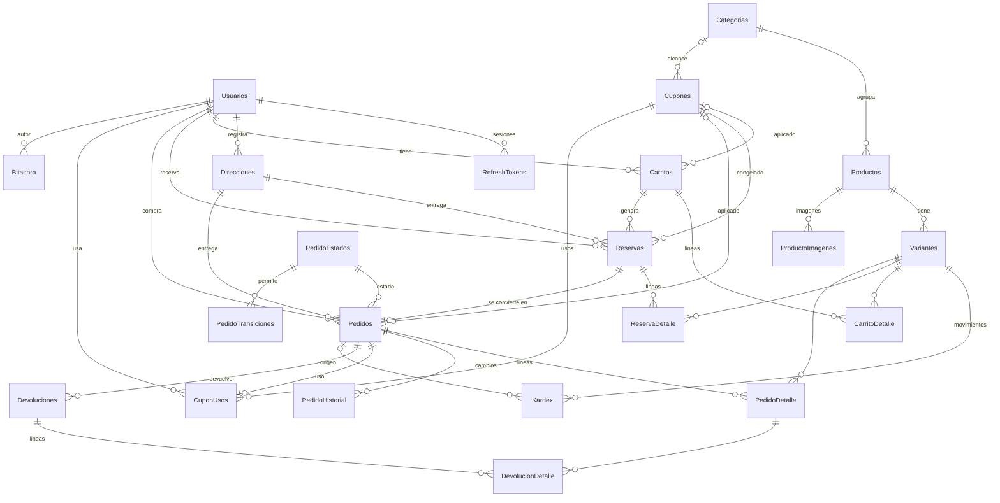
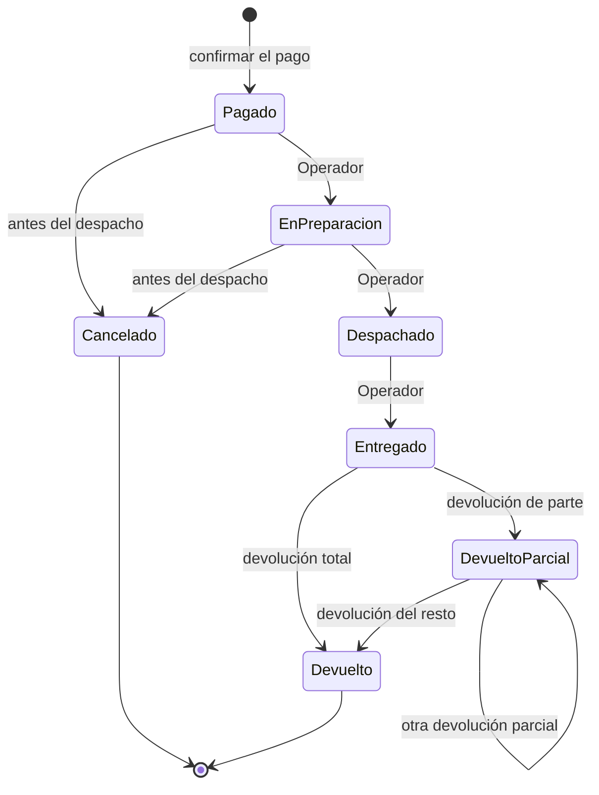
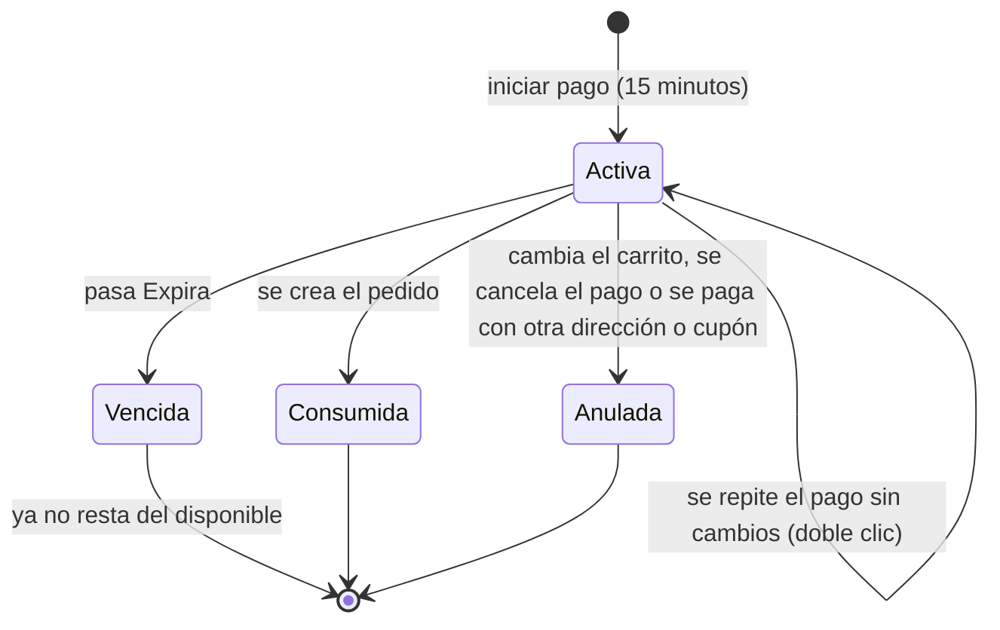

# ShopCart

Plataforma web de ventas con SQL Server, API en Express con TypeScript y frontend en React con TypeScript (Fase 2).
La especificación está en [docs/especificacion.md](docs/especificacion.md). Esta entrega (Fase 1) incluye la base de datos y el backend.

## Requisitos

- Docker con Docker Compose.
- Node.js 24 o superior, solo para desarrollar la API fuera de Docker.

## Instalación

```bash
git clone https://github.com/eramirez150/shopcart.git
cd shopcart
cp .env.example .env
```

Editar `.env` y definir estos tres valores, sin comillas. Si falta alguno, `docker compose` se detiene con un error.

| Variable | Descripción |
| --- | --- |
| `MSSQL_SA_PASSWORD` | Clave de `sa`: mínimo 8 caracteres con mayúsculas, minúsculas, números y símbolos |
| `APP_DB_PASSWORD` | Clave de `shopcart_app`, con las mismas reglas |
| `JWT_SECRET` | Al menos 32 caracteres aleatorios |

```bash
docker compose up --build
```

La API queda en `http://localhost:3000/api` y su documentación en `http://localhost:3000/api/docs`. La base de datos queda disponible solo desde la propia máquina en `127.0.0.1,14335`. Los scripts de `database/` se aplican en orden: `00_base` crea la base, tablas y semillas se aplican una sola vez, y funciones, vistas, procedimientos y permisos en cada arranque.

### Usuario de la aplicación

La API no usa `sa`: usa `shopcart_app`, que solo tiene `EXECUTE` sobre los stored procedures por medio del rol `RolShopCartApp` (script `06_permisos/001_rol_aplicacion.sql`). `database/aplicar.sh` lo crea con la clave de `APP_DB_PASSWORD`.

### API fuera de Docker

```bash
cd api
npm install
```

Crear `api/.env` con estas variables (la API también las lee del entorno):

| Variable | Descripción | Por defecto |
| --- | --- | --- |
| `DB_HOST`, `DB_PORT`, `DB_NAME` | Dónde está la base | `127.0.0.1`, `14335`, `ShopCart` |
| `DB_USER`, `DB_PASSWORD` | Usuario de la aplicación (`shopcart_app`) | obligatorias |
| `JWT_SECRET` | Al menos 32 caracteres aleatorios. Generar con `node -e "console.log(require('crypto').randomBytes(48).toString('base64url'))"` | obligatoria |
| `JWT_ACCESS_MINUTES`, `JWT_REFRESH_DAYS` | Vida del token de acceso y del refresh token | `15`, `7` |
| `PORT`, `CORS_ORIGIN` | Puerto y orígenes permitidos separados por coma | `3000`, `http://localhost:5173` |

```bash
npm run dev      # desarrollo con recarga
npm run build && npm start
```

La documentación interactiva está en `http://localhost:3000/api/docs` (Swagger UI, con botón **Authorize** para pegar el JWT). El contrato escrito a mano es [api/openapi.yaml](api/openapi.yaml).

### Pruebas

```bash
cd api
npm run typecheck
npm test
```

`seguridad.test.ts` no necesita base de datos. Los demás archivos (`flujo`, `concurrencia`, `direcciones`, `dashboard`, `catalogo`, `orden` y `reglas`) exigen una base **recién creada** con todos los scripts y una conexión (`DB_USER` y `DB_PASSWORD`, o `TEST_DB_CONNECTION_STRING` con el controlador `msnodesqlv8` para SQL Server LocalDB). Sin conexión se omiten. Crean y modifican datos: usar una base de pruebas. Con Docker Compose, la base se recrea con `docker compose down -v` y `docker compose up -d db db-init`, y las pruebas se ejecutan desde `api/` con `DB_USER=shopcart_app` y `DB_PASSWORD` igual a `APP_DB_PASSWORD`.

Las pruebas que necesitan tocar la base directamente están en `database/pruebas/` (`aplicar.sh` no ejecuta esa carpeta) y se ejecutan con `sa`:

```bash
docker compose run --rm --entrypoint /bin/sh db-init /scripts/pruebas/ejecutar.sh
```

| Archivo | Qué comprueba |
| --- | --- |
| `permisos.sql` | `shopcart_app` solo puede ejecutar SP: no lee ni modifica tablas. |
| `bitacora.sql` | Ni siquiera `sa` puede modificar o borrar la bitácora (error 51403). |
| `transiciones.sql` | El trigger rechaza un `UPDATE` directo con una transición que no está en `PedidoTransiciones`, y las devoluciones siguen funcionando. |
| `reserva_vencida.sql` | Una reserva vencida deja de restar del disponible, otro cliente puede reservar esa existencia, ya no se convierte en pedido y un pago nuevo la anula. Adelanta `Expira` con un `UPDATE` para no esperar 15 minutos. |

Cada archivo deshace sus cambios o crea datos con nombres únicos, y termina con error ante el primer fallo.

## Credenciales de prueba

Solo para desarrollo, creadas por los scripts de `database/02_semillas`. Cámbielas o elimínelas en cualquier entorno real.

| Rol | Correo | Contraseña |
| --- | --- | --- |
| Administrador | `admin@shopcart.test` | `Admin123!` |
| Operador | `operador@shopcart.test` | `Operador123!` |
| Cliente | `cliente@shopcart.test` | `Cliente123!` |
| Cliente | `cliente2@shopcart.test` | `Cliente123!` |

Cupones de ejemplo: `BIENVENIDA10` (10 %, una vez por cliente), `Q50` (Q50 con compra mínima de Q300), `ELECTRO15` (15 % solo en Electrónica), `LIMITADO5` (5 usos en total), `VENCIDO` e `INACTIVO` (para ver los rechazos).

Datos de demostración (`02_semillas/002_demostracion.sql`), para que el dashboard no salga vacío: direcciones de los dos clientes, 14 pedidos de los últimos 75 días en todos los estados (con devoluciones parciales y totales y una cancelación) y 3 carritos abandonados (uno de `cliente2@shopcart.test` y dos de invitados). Ningún pedido es de hoy ni de ayer. Cada producto tiene una imagen de muestra de `picsum.photos`.

## Scripts de base de datos

Cada objeto vive en su propio archivo y el archivo se llama como el objeto (`SP_Pedidos_Listar.sql`). `aplicar.sh` recorre las carpetas en orden numérico y, dentro de cada una, los archivos en orden alfabético.

```text
database/
  00_base/            Crea la base (001_crear_base.sql) y el registro de scripts (002_scripts_aplicados.sql)
  01_tablas/          Tablas, índices y triggers por módulo (001_usuarios, 002_catalogo, ...)
  02_semillas/        001: usuarios por rol, categorías, 50 productos con imagen, kardex y cupones
                      002: direcciones, pedidos, devoluciones y carritos abandonados de demostración
  03_funciones/       FU_Modulo_Proceso.sql
  04_vistas/          VW_Modulo_Proceso.sql
  05_procedimientos/  Una subcarpeta por módulo, con SP_Modulo_Proceso.sql
  06_permisos/        Rol de aplicación con solo EXECUTE
  pruebas/            Pruebas SQL y su ejecutor (ejecutar.sh); aplicar.sh no las ejecuta
  aplicar.sh
```

| Carpeta | Cómo se aplica |
| --- | --- |
| `00_base` | En cada ejecución y fuera de transacción (`CREATE DATABASE` no se permite dentro de una). `001_crear_base.sql` se ejecuta en `master` con la variable de sqlcmd `DB_NAME`; si la base o la tabla ya existen no hace nada. |
| `01_tablas`, `02_semillas` | Una sola vez. Cada archivo se registra en `dbo.ScriptsAplicados` con su ruta relativa. |
| `03_funciones` a `06_permisos` | En cada ejecución, con `CREATE OR ALTER`. No se registran: un cambio en un SP llega a una base que ya existe. |

- Cada archivo se ejecuta en su propia transacción (en `01` y `02`, junto con su registro). Si algo falla, no queda nada a medias y el contenedor `db-init` termina con error.
- Un archivo no abre ni confirma transacciones propias.
- Las tablas no se pueden reaplicar: un cambio en una tabla ya creada exige un archivo nuevo en `01_tablas` (por ejemplo `010_cambio.sql` con `ALTER TABLE`), nunca editar el existente. Excepción de esta entrega: como todavía no hay ninguna base entregada, las correcciones de la Fase 1 editaron `01_tablas` y `02_semillas` directamente; una base creada antes de estas correcciones se debe recrear (`docker compose down -v`).
- Para crear la base sin Docker: ejecutar `00_base/001_crear_base.sql` en `master` (`sqlcmd -v DB_NAME=ShopCart`; en SSMS, modo SQLCMD con `:setvar DB_NAME ShopCart`) y luego los demás archivos en el orden descrito.
- Si una vista o función depende de otra, se les pone un prefijo numérico para que se creen en orden. Hoy ninguna lo necesita.

### Agregar un procedimiento

1. Crear `database/05_procedimientos/<Modulo>/SP_<Modulo>_<Proceso>.sql` con una sola instrucción `CREATE OR ALTER PROCEDURE dbo.SP_<Modulo>_<Proceso>` y `GO` al final.
2. Poner encima un comentario breve que explique qué hace.
3. Ejecutar `docker compose up db-init`: el archivo nuevo se aplica y los demás se reaplican sin cambios.

Una función se agrega igual en `03_funciones` y una vista en `04_vistas`. El módulo es la carpeta; los errores se lanzan con `THROW 52000 + código HTTP`.

### Vistas de control

Son de solo lectura, sirven para revisar desde SSMS y la API no las usa.

| Vista | Qué muestra |
| --- | --- |
| `VW_Inventario_Control` | Una fila por variante: existencia, reservado, disponible y la diferencia con la suma del kardex, que debe ser 0. |
| `VW_Pedidos_Resumen` | Una fila por pedido: cliente, estado, líneas, unidades, devoluciones, totales y cupón. |

```sql
SELECT * FROM dbo.VW_Inventario_Control WHERE DiferenciaKardex <> 0;
SELECT * FROM dbo.VW_Pedidos_Resumen ORDER BY FechaCreacion DESC;
```

### Reglas por módulo

- Un pedido completado es `Entregado` o `DevueltoParcial`; las ventas del dashboard son netas de devoluciones.
- Ticket promedio = monto total vendido ÷ número de pedidos pagados del periodo, como lo define el glosario. Un pedido pagado es cualquiera menos `Cancelado`; el monto vendido es la suma de su `Total` (lo cobrado, sin restar devoluciones). El resto del dashboard usa ventas netas.
- Carrito abandonado: abierto, con productos y sin cambios en las últimas 24 horas. Las 24 horas son el valor por defecto del parámetro `horas` de `/dashboard/indicadores` y `/dashboard/carritos-abandonados`.
- Cualquier cambio en el carrito anula su reserva activa: el cliente debe iniciar el pago otra vez. Repetir el inicio del pago **sin** cambios devuelve la misma reserva (doble clic).
- Direcciones: cada usuario registra, lista, modifica y desactiva las suyas en `/api/direcciones`; la de otro usuario responde 404 en la API y en los SP. Al pagar se elige una con `idDireccion` o se envía el texto de una nueva, que queda registrada (si ya existe una idéntica se reutiliza). Reservas y pedidos guardan `IDDireccion` y copian el texto, así modificar o desactivar la dirección después no altera un pedido.
- Las devoluciones solo las registra un Operador o un Administrador (`POST /api/pedidos/{id}/devoluciones`); el Cliente consulta las de sus pedidos.
- Las escrituras del catálogo exigen rol Administrador y nada con ventas o movimientos se elimina: se desactiva. Las variantes y los cupones no tienen ruta para borrar: se desactivan con `activa: false` (`PUT /api/productos/variantes/{id}`) y `activo: false` (`PUT /api/cupones/{id}`), porque los referencian carritos, reservas, pedidos y usos.
- Los atributos de una variante se guardan como un objeto JSON en texto (`{"Talla":"M","Color":"Azul"}`), validado con `ISJSON`; la API los recibe y devuelve como objeto. Así cada categoría define sus propios atributos sin tablas adicionales.
- Imágenes: cada producto tiene cero o más imágenes (`ProductoImagenes`) con URL http(s), texto alternativo y orden; la de menor orden es la principal y aparece en la búsqueda. Se guardan solo las URL: el archivo vive fuera de la base. Quitar una imagen la elimina, porque no tiene ventas ni movimientos.
- Catálogo de administración: `GET /api/productos/administracion` lista también productos inactivos, de categorías inactivas y sin variantes. La búsqueda pública solo muestra productos activos con variantes activas.
- Los listados de pedidos, usuarios, cupones, kardex, existencias, bitácora y catálogo aceptan `orden`; el SP valida el valor y ordena con `CASE`, sin SQL dinámico.
- Una salida o un ajuste manual no puede dejar la existencia por debajo de lo reservado por pagos en curso: responde 409 e indica cuánto se puede retirar.
- El hash de la contraseña lo calcula la API (bcrypt); del refresh token solo se guarda su SHA-256.
- Los errores usan `THROW` con `52000` más el código HTTP: `52400` datos inválidos, `52401` no autenticado, `52403` sin permiso, `52404` no existe y `52409` conflicto con el estado actual.

## Decisiones técnicas

| Riesgo | Decisión |
| --- | --- |
| Sobreventa | `SP_Checkout_IniciarPago` bloquea las variantes con `UPDLOCK, HOLDLOCK` en orden de `IDVariante` y compara contra el disponible. Una prueba lanza 25 compras simultáneas de 4 unidades y exactamente 4 pasan. |
| Reserva vencida | Disponible = existencia − reservas `Activa` con `Expira` futura (`FU_Inventario_Disponibilidad`). Sin proceso programado. Iniciar el pago otra vez anula la reserva anterior si está vencida o si cambió la dirección o el cupón. |
| Doble clic en pagar | `SP_Checkout_IniciarPago` bloquea el carrito; si ya tiene una reserva activa, no vencida, con la misma dirección y el mismo cupón, la devuelve sin anularla. Como todo cambio del carrito anula su reserva, una reserva activa implica un carrito sin cambios. Una prueba lanza 10 inicios de pago simultáneos y todos reciben la misma reserva. |
| Reservado y ajustes | `SP_Inventario_Registrar` bloquea la variante igual que el checkout y rechaza una salida o ajuste que deje la existencia por debajo de lo reservado. |
| Precio congelado | `ReservaDetalle` guarda precio y descuento; `PedidoDetalle` los copia. |
| Pedido duplicado | `Pedidos.IDReserva` es `UNIQUE` y la fila de la reserva se bloquea: un reintento espera y devuelve el mismo pedido. |
| Cupón concurrente | `UPDATE Cupones SET Usos = Usos + 1 WHERE Usos < LimiteTotal` y revisión de `@@ROWCOUNT`; la misma transacción revisa el límite por cliente. |
| Descuento exacto | El descuento total se calcula una vez y se reparte por líneas con diferencias de sumas acumuladas redondeadas: las líneas suman exactamente el total y nunca superan su valor. |
| Datos de otro cliente | `@IDUsuario` sale del JWT. Los SP que reciben `@IDUsuario` (carrito, direcciones, checkout, pedidos, devoluciones, cupones, usuarios, reportes, bitácora y escrituras del catálogo y del inventario) vuelven a verificar el rol y la propiedad. Los SP de lectura de inventario (`SP_Inventario_ListarExistencias`, `SP_Inventario_ConsultarKardex`) y de catálogo (`SP_Catalogo_BuscarProductos`, `SP_Catalogo_ObtenerProducto`, `SP_Categorias_Listar`) no reciben usuario: el catálogo es público y el inventario depende de que la API exija rol Operador o Administrador. |
| Estados | Tabla `PedidoTransiciones`, validada en el servicio, en `SP_Pedidos_CambiarEstado` y en el trigger `TR_Pedidos_ValidarTransicion` (AFTER UPDATE), que rechaza con 52409 cualquier cambio de estado fuera de la tabla aunque no pase por los SP. |
| Existencia | Solo `SP_Inventario_RegistrarMovimiento` la cambia, junto con su fila de kardex en la misma transacción. |
| Bitácora | Triggers sobre productos, variantes, cupones y estado de pedidos, más un trigger `INSTEAD OF UPDATE, DELETE` que la hace inmutable. El SP guarda el usuario con `sp_set_session_context`. |
| Permisos | Rol `RolShopCartApp` con `EXECUTE` y nada más. Se verifica en `database/pruebas/permisos.sql`. |
| Errores | Los SP lanzan `THROW 52000 + código HTTP` (`52409` es 409). La API lo traduce en un solo lugar. |
| Sesiones | Access token de 15 minutos (token expirado: 401). Refresh token aleatorio de un solo uso: en la base solo se guarda su SHA-256; reusar uno revocado cierra todas las sesiones del usuario. Contraseñas con bcrypt (costo 10). |
| Venta neta | Un pedido completado es `Entregado` o `DevueltoParcial`. El dashboard descuenta las devoluciones y las fechas filtran por la del pedido. El ticket promedio es la excepción: monto vendido entre pedidos pagados, según el glosario. |
| Pago | Simulado: confirmar el pago crea el pedido con una referencia única. |

Limitaciones conocidas: un usuario desactivado conserva su token de acceso hasta que vence (15 minutos) y no puede renovarlo ni pagar, aunque puede seguir modificando su carrito durante ese tiempo; no hay límite de intentos de inicio de sesión.

## Supuestos

El enunciado no define estos puntos, así que se decidieron de esta forma:

- Un pedido completado es `Entregado` o `DevueltoParcial`.
- Cancelar devuelve el uso del cupón; una devolución no lo devuelve.
- Modificar el carrito anula la reserva activa.
- Se puede armar el carrito como invitado, pero pagar exige iniciar sesión.
- Un pedido usa como máximo un cupón.
- Un pedido pagado es cualquier pedido que no esté `Cancelado` (el pago simulado ocurre al crearlo); el ticket promedio usa su total cobrado.
- Se puede pagar con una dirección nueva sin registrarla antes: queda guardada en las direcciones del cliente.
- Las imágenes son URL externas; subir archivos queda fuera de la Fase 1.
- Los precios publicados incluyen IVA del 12 %: el IVA del pedido se calcula a partir del total y no se suma.
- El pago es simulado porque el enunciado no exige pasarela.

## Librerías

Todas respetan el stack obligatorio. Ninguna accede a datos por su cuenta: `mssql` solo ejecuta stored procedures.

| Librería | Para qué se usa | Por qué |
| --- | --- | --- |
| `express` | Servidor HTTP y rutas | Exigida por el stack |
| `mssql` | Ejecutar stored procedures con parámetros tipados | Controlador de SQL Server para Node.js; no es un ORM |
| `zod` | Validar los datos de entrada | Los esquemas son breves y dan tipos de TypeScript |
| `jsonwebtoken` | Firmar y verificar los tokens de acceso | Implementación estándar de JWT |
| `bcryptjs` | Guardar el hash de las contraseñas | Escrita en JavaScript: no necesita compilar código nativo en Docker |
| `helmet` | Cabeceras de seguridad | Las configura en un solo lugar |
| `cors` | Definir los orígenes permitidos | Middleware habitual de Express |
| `swagger-ui-express` | Publicar la documentación en `/api/docs` | Muestra `openapi.yaml` y su botón para autorizar con JWT |
| `yaml` | Leer `openapi.yaml` al iniciar | Node.js no lee YAML por sí solo |

Solo para desarrollo: `typescript` compila el código, `tsx` ejecuta TypeScript en modo de desarrollo y en las pruebas, y los paquetes `@types/*` aportan los tipos de las librerías.

## Modelo entidad-relación



## Diagramas de estados

Pedido (las transiciones salen de `PedidoTransiciones`):



Reserva de existencia:



`Vencida` no es un valor guardado: es una reserva `Activa` con `Expira` en el pasado.

## Flujo de compra

1. `POST /api/carrito/items` agrega productos (con sesión o con `X-Carrito-Token` de invitado).
2. `PUT /api/carrito/cupon` aplica un cupón.
3. `GET /api/direcciones` lista las direcciones del cliente; `POST /api/direcciones` registra una.
4. `POST /api/checkout/pagos` con `idDireccion` (o el texto de una dirección nueva) reserva la existencia 15 minutos.
5. `POST /api/checkout/reservas/{id}/pedido` confirma el pago simulado y crea el pedido.
6. El Operador avanza el pedido con `PATCH /api/pedidos/{id}/estado`; las devoluciones se registran en `POST /api/pedidos/{id}/devoluciones`.

## Estado de la verificación

Las correcciones de la Fase 1 se verificaron con SQL Server 2022 en Docker (`mcr.microsoft.com/mssql/server:2022-latest`) y Node.js 22:

- `docker compose up db db-init` sobre un volumen vacío crea la base desde `00_base`, aplica todos los scripts y termina con código 0; una segunda ejecución omite tablas y semillas y también termina con código 0.
- `npx tsc --noEmit` sin errores y `npm test` con 36 pruebas aprobadas sobre una base recién creada.
- `database/pruebas/ejecutar.sh` con las cuatro pruebas SQL aprobadas.
- `VW_Inventario_Control` sin diferencias entre la existencia y el kardex después de las semillas.
- `docker compose up` con los tres servicios: `db-init` termina con código 0 y la API (imagen `node:24-alpine`) responde en `/api/salud`, `/api/docs` y el dashboard con los datos de demostración.

`npm test` se ejecutó con Node.js 22; la API en Node.js 24 solo se probó dentro de Docker. No se volvió a probar en SQL Server LocalDB 2019.
