# ShopCart

Plataforma web de ventas con SQL Server, dos servicios en Express con TypeScript (tienda y administración) y frontend en React con TypeScript.
La especificación está en [docs/especificacion.md](docs/especificacion.md). La Fase 1 entregó la base de datos y la API; la Fase 2 agrega el frontend en `web/`, con la tienda y el panel en contenedores separados.

## Entregas

| Fase | Alcance | Cierre | Dónde verla |
| --- | --- | --- | --- |
| 1 | Base de datos y backend (dos servicios de API) | 2 de noviembre de 2026 | Tag [`fase-1`](https://github.com/eramirez150/shopcart/releases/tag/fase-1) |
| 2 | Frontend (tienda y panel) y proyecto completo | 9 de noviembre de 2026 | Tag [`fase-2`](https://github.com/eramirez150/shopcart/releases/tag/fase-2) y rama `main` |

La rama `main` contiene la Fase 2 completa. Lo agregado en la Fase 2:

- Tienda: catálogo, búsqueda, detalle con variantes y reseñas, carrito de invitado, cupones, checkout y "Mi cuenta" con el seguimiento del envío.
- Panel de administración: dashboard, pedidos con despacho y entrega, inventario y kardex, catálogo y precios, cupones, usuarios, roles y permisos, y bitácora.
- Despacho y entrega: mensajería, guía, peso y costo de recogida al despachar, y quién recibió al entregar.
- Dos aplicaciones web separadas, cada una con su contenedor, su login y su servicio de API.

## Cómo se ve

Capturas tomadas con Chrome sobre una base recién creada y los datos de demostración.

| Tienda en computadora | Tienda en celular | Producto |
| --- | --- | --- |
| 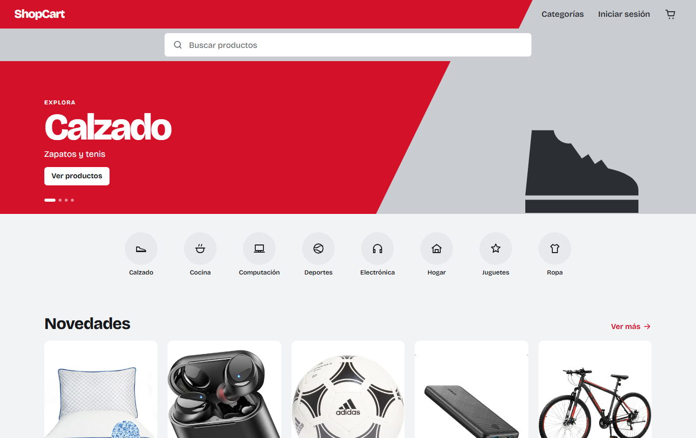 | 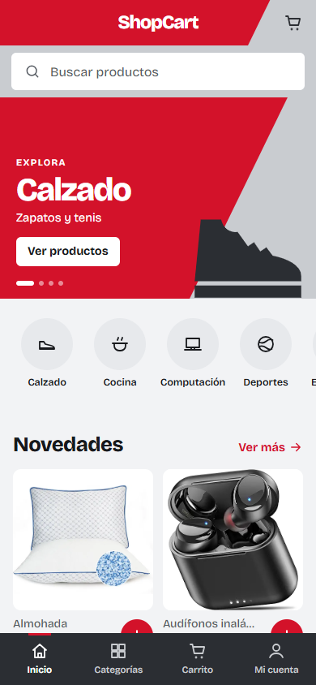 | 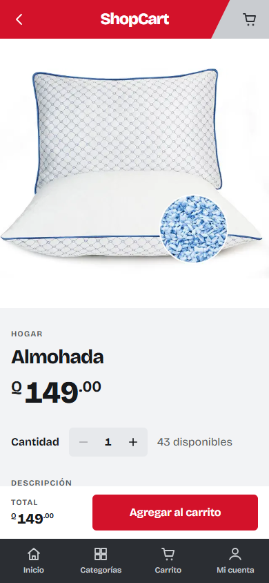 |

| Carrito | Seguimiento del pedido (cliente) |
| --- | --- |
| 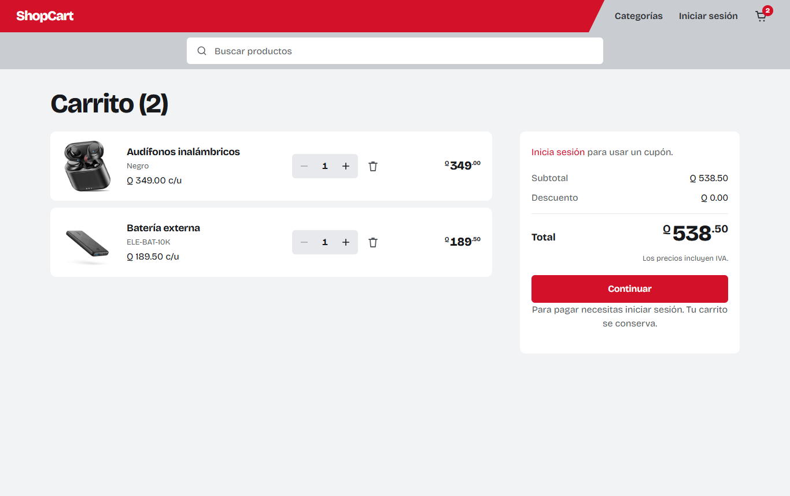 | 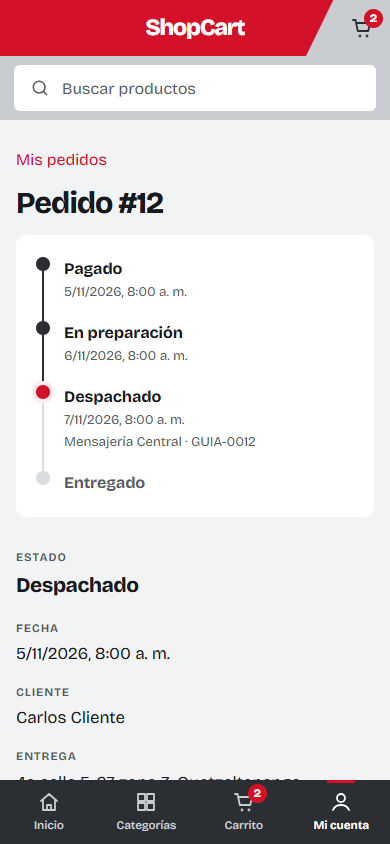 |

| Operador: pedidos por despachar | Operador: pedido con envío |
| --- | --- |
| 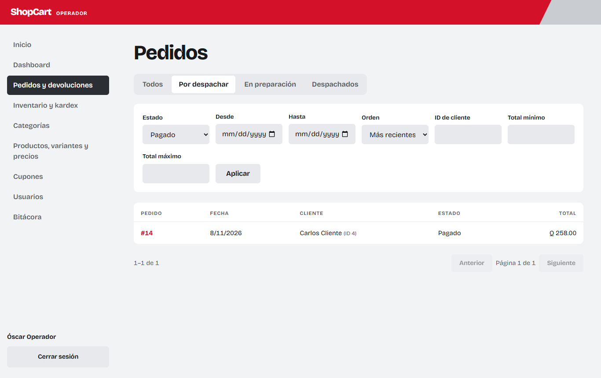 | 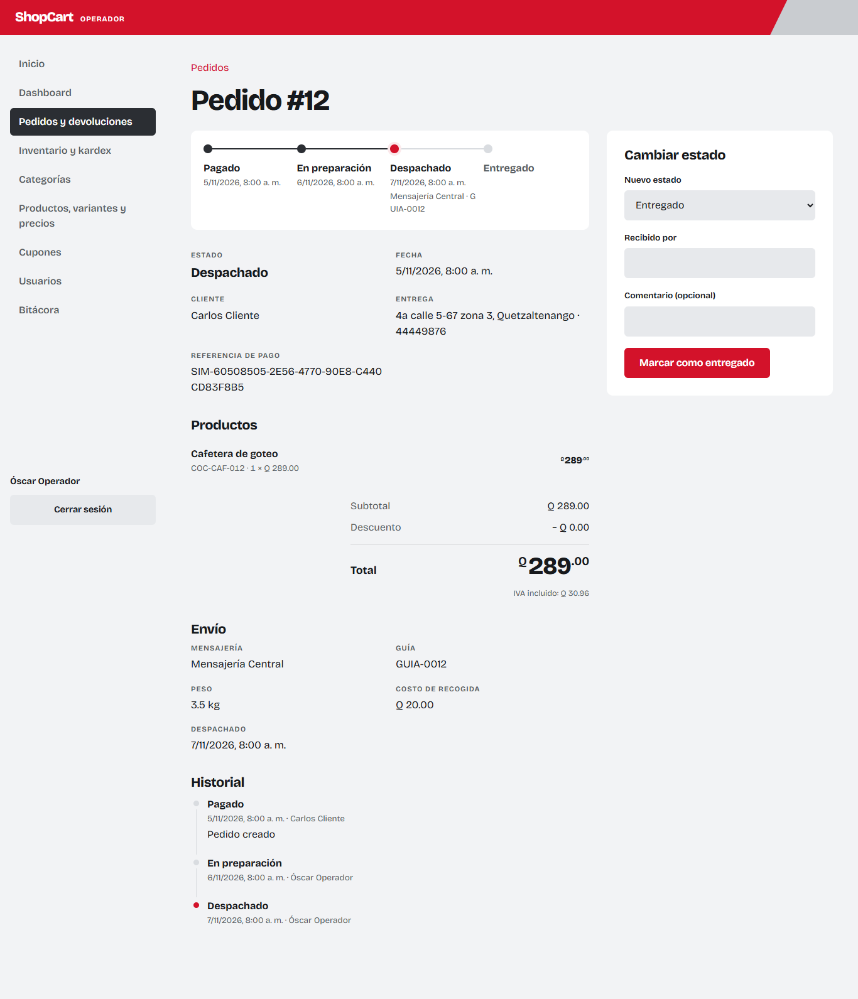 |

| Administrador: dashboard | Administrador: roles y permisos | Panel en celular |
| --- | --- | --- |
| 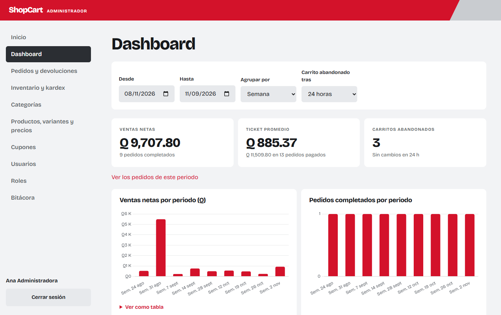 | 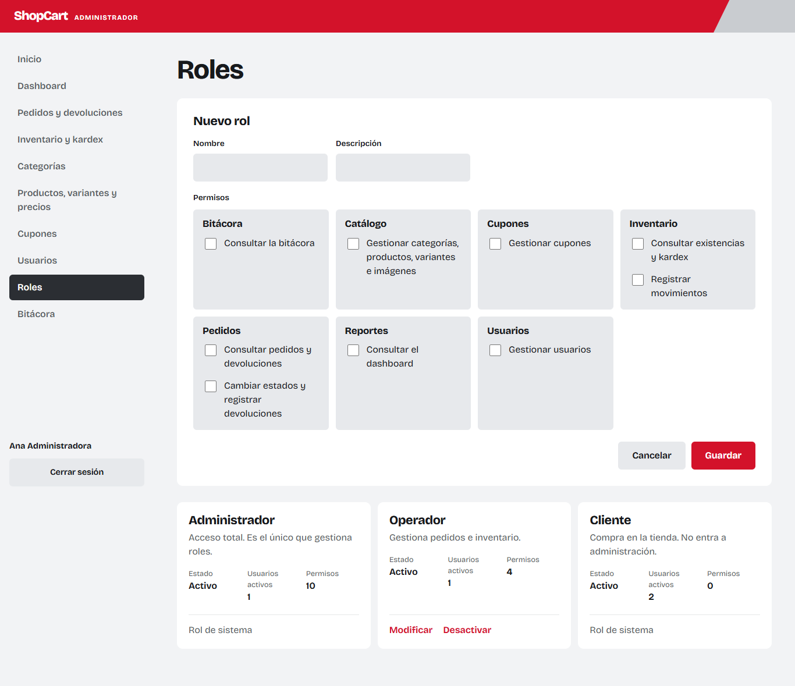 | 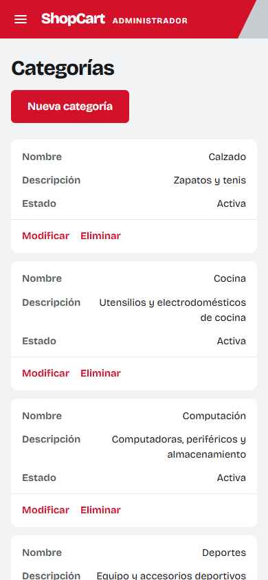 |

Recorrido del pedido: el cliente paga, el operador lo pasa a En preparación, lo marca como despachado con mensajería, guía, peso y costo de recogida, y luego como entregado con el nombre de quien recibió. El cliente ve cada paso con su fecha en "Mi cuenta"; el costo de recogida solo lo ve el personal.

## Arquitectura

Cada aplicación web habla solo con su servicio, y los dos servicios comparten base y stored procedures.

| Aplicación | Compilación | Contenedor web | Puerto | Reenvía `/api` a | Quién entra |
| --- | --- | --- | --- | --- | --- |
| Tienda | `VITE_APP=tienda` | `web-tienda` | `8081` | `api-tienda:3000` (`/api/publico`, `/api/cliente`) | Clientes |
| Panel | `VITE_APP=admin` | `web-admin` | `8082` | `api-admin:3001` (`/api/admin`) | Personal |

## Requisitos

- Docker con Docker Compose.
- Node.js 24 o superior, solo para desarrollar la API o el frontend fuera de Docker.

## Instalación

```bash
git clone https://github.com/eramirez150/shopcart.git
cd shopcart
cp .env.example .env
```

Editar `.env` y definir estos tres valores, sin comillas. Si falta alguno, `docker compose` se detiene con un error.

| Variable | Descripción |
| --- | --- |
| `MSSQL_SA_PASSWORD` | Clave de `sa`: mínimo 8 caracteres con mayúsculas, minúsculas, números y símbolos |
| `APP_DB_PASSWORD` | Clave de `shopcart_app`, con las mismas reglas |
| `JWT_SECRET` | Al menos 32 caracteres aleatorios |
| `VITE_MODO_DEMO` | Opcional. `true` muestra en cada login los botones para entrar con las cuentas de prueba. Por defecto `false` |
| `WEB_TIENDA_PORT`, `WEB_ADMIN_PORT` | Opcionales. Puertos de la tienda y del panel en la máquina. Por defecto `8081` y `8082` |

```bash
docker compose up --build
```

Se levantan seis servicios: `db`, `db-init` (aplica los scripts y termina), `api-tienda`, `api-admin`, `web-tienda` y `web-admin`. **La tienda queda en `http://127.0.0.1:8081` y el panel en `http://127.0.0.1:8082`** (también con `localhost`). Cada contenedor web sirve su compilación con nginx y reenvía `/api` a su servicio, así que el navegador usa un solo origen por aplicación. `VITE_APP` y `VITE_MODO_DEMO` se fijan al compilar: después de cambiar `VITE_MODO_DEMO`, ejecutar otra vez `docker compose up --build`. Para empezar con una base limpia: `docker compose down -v`.

La tienda queda en `http://localhost:3000/api` y administración en `http://localhost:3001/api`, cada una con su documentación en `/api/docs`. Ver [Cómo consumir las API](#cómo-consumir-las-api). La base de datos queda disponible solo desde la propia máquina en `127.0.0.1,14335`. Los scripts de `database/` se aplican en orden: `00_base` crea la base, tablas y semillas se aplican una sola vez, y funciones, vistas, procedimientos y permisos en cada arranque.

### Usuario de la aplicación

Los servicios no usan `sa`: usa `shopcart_app`, que solo tiene `EXECUTE` sobre los stored procedures por medio del rol `RolShopCartApp` (script `06_permisos/001_rol_aplicacion.sql`). `database/aplicar.sh` lo crea con la clave de `APP_DB_PASSWORD`.

### Servicios fuera de Docker

```bash
cd api
npm install
```

Crear `api/.env` con estas variables (también se leen del entorno):

| Variable | Descripción | Por defecto |
| --- | --- | --- |
| `DB_HOST`, `DB_PORT`, `DB_NAME` | Dónde está la base | `127.0.0.1`, `14335`, `ShopCart` |
| `DB_USER`, `DB_PASSWORD` | Usuario de la aplicación (`shopcart_app`) | obligatorias |
| `JWT_SECRET` | Al menos 32 caracteres aleatorios. Generar con `node -e "console.log(require('crypto').randomBytes(48).toString('base64url'))"` | obligatoria |
| `JWT_ACCESS_MINUTES`, `JWT_REFRESH_DAYS` | Vida del token de acceso y del refresh token | `15`, `7` |
| `PORT`, `CORS_ORIGIN` | Puerto y orígenes permitidos del servicio, separados por coma | Tienda: `3000`, `http://localhost:5173`. Administración: `3001`, `http://localhost:5174` |

```bash
npm run dev        # tienda con recarga
npm run dev:admin  # administración con recarga
npm run build
npm start          # tienda
npm run start:admin
```

`PORT` y `CORS_ORIGIN` valen para un proceso: si se definen en `api/.env`, los dos servicios reciben el mismo valor. Para levantar ambos desde el mismo `.env`, omitirlas o pasarlas al lanzar cada uno.

La documentación interactiva de cada servicio está en `/api/docs` (Swagger UI, con botón **Authorize** para pegar el JWT). Los contratos escritos a mano son [api/openapi-tienda.yaml](api/openapi-tienda.yaml) y [api/openapi-admin.yaml](api/openapi-admin.yaml).

### Frontend fuera de Docker

Con la base y los servicios levantados (por ejemplo `docker compose up -d db db-init api-tienda api-admin`):

```bash
cd web
npm install
npm run dev        # tienda en http://localhost:5173, con recarga
npm run dev:admin  # panel en http://localhost:5174, con recarga
```

Vite reenvía `/api` a `http://localhost:3000` en la tienda y a `http://localhost:3001` en el panel; otro destino se indica con `API_PROXY` en el entorno o en `web/.env`. Las variables del navegador están en `web/.env.example` (`VITE_API_URL`, por defecto `/api`, y `VITE_MODO_DEMO`). `VITE_APP` elige la aplicación; los comandos `:admin` la fijan con `--mode admin`, que funciona igual en Windows y en Linux.

```bash
npm run typecheck  # comprobación de tipos (tsc --noEmit, modo strict)
npm run build      # tipos y compilación de la tienda a web/dist
npm run build:admin  # lo mismo para el panel
```

Estructura de `web/src`:

```text
api/          Cliente de la API (token, renovación, errores), tipos de las respuestas y useApi
sesion/       Sesión del usuario y rutas protegidas
componentes/  Estados de carga, vacío y error, paginación, campos, filtros en la URL, detalle de pedido, página no encontrada
tienda/       Encabezado, inicio, búsqueda, detalle, carrito y checkout
cuenta/       Mi cuenta: pedidos y direcciones
panel/        Panel del personal y dashboard
paginas/      Login y registro
AppTienda.tsx Rutas de la tienda
AppPanel.tsx  Rutas del panel
main.tsx      Elige la aplicación según VITE_APP
estilos.css   Estilos (un solo archivo, primero para celular)
```

### Pruebas

```bash
cd api
npm run typecheck
npm test
```

`servicios.test.ts` no necesita base de datos y tampoco el primer bloque de `seguridad.test.ts` y de `sesiones.test.ts`. Lo demás (`roles`, `flujo`, `concurrencia`, `direcciones`, `dashboard`, `despacho`, `catalogo`, `orden`, `reglas`, `resenas`, `relacionados` y los segundos bloques de `seguridad` y `sesiones`) exige una base **recién creada** con todos los scripts y una conexión (`DB_USER` y `DB_PASSWORD`, o `TEST_DB_CONNECTION_STRING` con el controlador `msnodesqlv8` para SQL Server LocalDB). Sin conexión se omiten. Crean y modifican datos: usar una base de pruebas. Con Docker Compose, la base se recrea con `docker compose down -v` y `docker compose up -d db db-init`, y las pruebas se ejecutan desde `api/` con `DB_USER=shopcart_app` y `DB_PASSWORD` igual a `APP_DB_PASSWORD`.

Las pruebas que necesitan tocar la base directamente están en `database/pruebas/` (`aplicar.sh` no ejecuta esa carpeta) y se ejecutan con `sa`:

```bash
docker compose run --rm --entrypoint /bin/sh db-init /scripts/pruebas/ejecutar.sh
```

En Git Bash para Windows, anteponer `MSYS_NO_PATHCONV=1` para que no reescriba `/bin/sh`.

| Archivo | Qué comprueba |
| --- | --- |
| `permisos.sql` | `shopcart_app` solo puede ejecutar SP: no lee ni modifica tablas, incluidas las de roles. `FU_Auth_TienePermiso` da todo al Administrador, nada de personal al Cliente y al Operador solo pedidos e inventario; ningún rol tiene `roles.gestionar` en `RolPermisos`. |
| `bitacora.sql` | Ni siquiera `sa` puede modificar o borrar la bitácora (error 51403). |
| `resenas.sql` | `SP_Resenas_Crear` rechaza a quien no tiene un pedido `Entregado` con el producto, a otro rol y una segunda reseña, y la tabla rechaza una calificación fuera de 1 a 5. |
| `despacho.sql` | `SP_Pedidos_CambiarEstado` exige los datos de despacho y entrega, los guarda en `PedidoEnvios` en la misma transacción que el estado y deja pasar las demás transiciones sin ellos. Los CHECK rechazan peso cero y costo negativo. |
| `transiciones.sql` | El trigger rechaza un `UPDATE` directo con una transición que no está en `PedidoTransiciones`, y las devoluciones siguen funcionando. |
| `reserva_vencida.sql` | Una reserva vencida deja de restar del disponible, otro cliente puede reservar esa existencia, ya no se convierte en pedido y un pago nuevo la anula. Adelanta `Expira` con un `UPDATE` para no esperar 15 minutos. |

Cada archivo deshace sus cambios o crea datos con nombres únicos, y termina con error ante el primer fallo.

## Cómo consumir las API

Son dos servicios sobre la misma base y los mismos stored procedures. Una ruta sigue siempre el camino ruta, servicio, repositorio y SP.

| Servicio | Puerto | Prefijos | Sesión | Documentación |
| --- | --- | --- | --- | --- |
| Tienda | 3000 | `/api/publico` | No necesita (el cupón del carrito sí) | `http://localhost:3000/api/docs` |
| Tienda | 3000 | `/api/cliente` | Cliente | `http://localhost:3000/api/docs` |
| Administración | 3001 | `/api/admin` | Personal, salvo `/api/admin/auth` | `http://localhost:3001/api/docs` |

`/api/salud` responde en los dos e indica cuál contestó. Una ruta del otro servicio responde 404. El token y el refresh token de un servicio responden 401 en el otro.

Llamada pública:

```bash
curl "http://localhost:3000/api/publico/productos?texto=mouse&orden=precio_asc"
```

Login de cliente y llamada privada:

```bash
curl -X POST http://localhost:3000/api/publico/auth/login \
  -H "Content-Type: application/json" \
  -d '{"correo":"cliente@shopcart.test","clave":"Cliente123!"}'
# Copiar accessToken de la respuesta.
curl http://localhost:3000/api/cliente/pedidos -H "Authorization: Bearer <accessToken>"
```

Login de administración y llamada privada:

```bash
curl -X POST http://localhost:3001/api/admin/auth/login \
  -H "Content-Type: application/json" \
  -d '{"correo":"admin@shopcart.test","clave":"Admin123!"}'
curl http://localhost:3001/api/admin/dashboard/indicadores -H "Authorization: Bearer <accessToken>"
```

Carrito de invitado: el primer agregado devuelve `TokenInvitado`, que se envía en `X-Carrito-Token`. Al iniciar sesión con esa cabecera el carrito pasa a la cuenta. Aplicar un cupón exige sesión porque el cupón tiene límite por cliente.

```bash
curl -X POST http://localhost:3000/api/publico/carrito/items \
  -H "Content-Type: application/json" \
  -d '{"idVariante":1,"cantidad":2}'
curl http://localhost:3000/api/publico/carrito -H "X-Carrito-Token: <TokenInvitado>"
```

Crear un rol con permisos y asignarlo (solo el Administrador gestiona roles):

```bash
curl http://localhost:3001/api/admin/permisos -H "Authorization: Bearer <accessToken>"
curl -X POST http://localhost:3001/api/admin/roles \
  -H "Authorization: Bearer <accessToken>" -H "Content-Type: application/json" \
  -d '{"nombre":"Marketing","descripcion":"Cupones y reportes","permisos":["cupones.gestionar","reportes.ver"]}'
curl -X POST http://localhost:3001/api/admin/usuarios \
  -H "Authorization: Bearer <accessToken>" -H "Content-Type: application/json" \
  -d '{"correo":"marketing@shopcart.test","clave":"Clave-segura-1","nombre":"Marta Marketing","rol":"Marketing"}'
```

Las aplicaciones de `web/` no dependen de CORS: llaman a `/api` en su propio origen. Para otros clientes, cada servicio solo acepta sus orígenes. Con Docker Compose se definen en `.env`, separados por coma; dentro del contenedor los dos reciben una sola variable, `CORS_ORIGIN`. Un origen ajeno no recibe ninguna cabecera `Access-Control-Allow-*`, y `X-Carrito-Token` solo se permite en la tienda.

| Variable de Compose | Servicio | Por defecto |
| --- | --- | --- |
| `CORS_ORIGIN_TIENDA` | Tienda | `http://localhost:5173` |
| `CORS_ORIGIN_ADMIN` | Administración | `http://localhost:5174` |
| `API_TIENDA_PORT` | Tienda, puerto publicado | `3000` |
| `API_ADMIN_PORT` | Administración, puerto publicado | `3001` |
| `WEB_TIENDA_PORT` | Tienda web, puerto publicado | `8081` |
| `WEB_ADMIN_PORT` | Panel web, puerto publicado | `8082` |
| `DB_PORT` | Base de datos, puerto publicado | `14335` |

### Permisos

| Código | Permite |
| --- | --- |
| `pedidos.ver` | Consultar pedidos y devoluciones |
| `pedidos.gestionar` | Cambiar estados y registrar devoluciones |
| `inventario.ver` | Consultar existencias y kardex |
| `inventario.gestionar` | Registrar movimientos |
| `catalogo.gestionar` | Gestionar categorías, productos, variantes e imágenes |
| `cupones.gestionar` | Gestionar cupones |
| `usuarios.gestionar` | Gestionar usuarios |
| `reportes.ver` | Consultar el dashboard |
| `bitacora.ver` | Consultar la bitácora |
| `roles.gestionar` | Gestionar roles y permisos. Solo el Administrador; no se puede asignar |

Tener `modulo.gestionar` incluye `modulo.ver`, porque las escrituras también devuelven los datos. `Administrador` y `Cliente` son roles de sistema: no se editan ni se desactivan. `Operador` se puede editar y nace con pedidos e inventario. Un rol no se borra: se desactiva con `activo: false`, y no se puede si tiene usuarios activos. Los cambios quedan en la bitácora, módulo `Roles`.

## Credenciales de prueba

Solo para desarrollo, creadas por los scripts de `database/02_semillas`. Cámbielas o elimínelas en cualquier entorno real.

| Rol | Correo | Contraseña | Inicia sesión en |
| --- | --- | --- | --- |
| Administrador | `admin@shopcart.test` | `Admin123!` | Administración |
| Operador | `operador@shopcart.test` | `Operador123!` | Administración |
| Cliente | `cliente@shopcart.test` | `Cliente123!` | Tienda |
| Cliente | `cliente2@shopcart.test` | `Cliente123!` | Tienda |

Cupones de ejemplo: `BIENVENIDA10` (10 %, una vez por cliente), `Q50` (Q50 con compra mínima de Q300), `ELECTRO15` (15 % solo en Electrónica), `LIMITADO5` (5 usos en total), `VENCIDO` e `INACTIVO` (para ver los rechazos).

Datos de demostración (`02_semillas/002_demostracion.sql`), para que el dashboard no salga vacío: direcciones de los dos clientes, 14 pedidos de los últimos 75 días en todos los estados (con devoluciones parciales y totales y una cancelación, y con su fila de `PedidoEnvios` desde `Despachado`) y 3 carritos abandonados (uno de `cliente2@shopcart.test` y dos de invitados). Ningún pedido es de hoy ni de ayer.

Reseñas de prueba (`02_semillas/003_resenas.sql`): 34 reseñas inventadas en 12 productos con foto. **Son datos de prueba**: sus autores son 6 clientes desactivados (`resena1@shopcart.test` a `resena6@shopcart.test`), sin contraseña válida y sin pedidos, así que esas reseñas se escribieron directamente y no provienen de una compra real. Las reseñas creadas desde la tienda sí exigen un pedido `Entregado`.

## Datos de muestra

30 de los 50 productos muestran una foto de referencia; los otros 20 muestran la silueta de su categoría, para no enseñar una foto que no es suya. `001_semillas.sql` inserta una imagen de `picsum.photos` por producto y `002_fotos_reales.sql` la cambia por la foto elegida o la quita.

- Las fotos son referencias de demostración, alojadas por la tienda de origen (`m.media-amazon.com`). No son del proyecto, no se descargan ni se guardan en el repositorio. La tienda necesita internet para mostrarlas.
- Los nombres y las descripciones de los productos son propios: de la búsqueda solo se guarda la dirección de la imagen.
- `scraper/fotos-amazon.mjs` visitó una vez, con un Chrome normal, 30 páginas públicas de búsqueda, una por producto y una a la vez, con 4 a 8 segundos de pausa, sin cuenta y sin proxies. No evade CAPTCHA: si aparece uno o un bloqueo, la corrida termina con lo capturado y no reintenta.
- `scraper/fotos.json` guarda las candidatas de cada búsqueda y, en `imagen`, la elegida al revisarlas a mano. El comando `capturar` se niega a correr si ese archivo existe; para cambiar una foto se edita el archivo y se regenera la semilla sin visitar ningún sitio:

```sh
cd scraper
npm install
npm run semilla
```

## Scripts de base de datos

Cada objeto vive en su propio archivo y el archivo se llama como el objeto (`SP_Pedidos_Listar.sql`). `aplicar.sh` recorre las carpetas en orden numérico y, dentro de cada una, los archivos en orden alfabético.

```text
database/
  00_base/            Crea la base (001_crear_base.sql) y el registro de scripts (002_scripts_aplicados.sql)
  01_tablas/          Tablas, índices y triggers por módulo (001_usuarios, 002_catalogo, ...).
                      010_roles_permisos también crea los roles y el catálogo de permisos
  02_semillas/        001: usuarios por rol, categorías, 50 productos con imagen, kardex y cupones
                      002_demostracion: direcciones, pedidos, devoluciones y carritos abandonados de demostración
                      002_fotos_reales: fotos de referencia de 30 productos, generado desde scraper/fotos.json
                      003_resenas: reseñas de prueba de 12 productos y sus autores
  03_funciones/       FU_Modulo_Proceso.sql
  04_vistas/          VW_Modulo_Proceso.sql
  05_procedimientos/  Una subcarpeta por módulo, con SP_Modulo_Proceso.sql
  06_permisos/        Rol de aplicación con solo EXECUTE
  pruebas/            Pruebas SQL y su ejecutor (ejecutar.sh); aplicar.sh no las ejecuta
  aplicar.sh
```

| Carpeta | Cómo se aplica |
| --- | --- |
| `00_base` | En cada ejecución y fuera de transacción (`CREATE DATABASE` no se permite dentro de una). `001_crear_base.sql` se ejecuta en `master` con la variable de sqlcmd `DB_NAME`; si la base o la tabla ya existen no hace nada. |
| `01_tablas`, `02_semillas` | Una sola vez. Cada archivo se registra en `dbo.ScriptsAplicados` con su ruta relativa. |
| `03_funciones` a `06_permisos` | En cada ejecución, con `CREATE OR ALTER`. No se registran: un cambio en un SP llega a una base que ya existe. |

- Cada archivo se ejecuta en su propia transacción (en `01` y `02`, junto con su registro). Si algo falla, no queda nada a medias y el contenedor `db-init` termina con error.
- Un archivo no abre ni confirma transacciones propias.
- Las tablas no se pueden reaplicar: un cambio en una tabla ya creada exige un archivo nuevo en `01_tablas` (por ejemplo `010_cambio.sql` con `ALTER TABLE`), nunca editar el existente. Excepción de esta entrega: como todavía no hay ninguna base entregada, las correcciones de la Fase 1 editaron `01_tablas` y `02_semillas` directamente, incluidos el rol de `Usuarios`, la audiencia de `RefreshTokens` y el módulo `Roles` de la bitácora; una base creada antes de estas correcciones se debe recrear (`docker compose down -v`). La tabla `PedidoEnvios` llegó en un archivo nuevo, `011_pedido_envios.sql`, pero sus filas de demostración están en `002_demostracion.sql`, que no se vuelve a aplicar: una base de demostración ya creada también se debe recrear, porque sus pedidos despachados no tendrían envío y no se podrían entregar (409).
- Para crear la base sin Docker: ejecutar `00_base/001_crear_base.sql` en `master` (`sqlcmd -v DB_NAME=ShopCart`; en SSMS, modo SQLCMD con `:setvar DB_NAME ShopCart`) y luego los demás archivos en el orden descrito.
- Si una vista o función depende de otra, se les pone un prefijo numérico para que se creen en orden. Hoy ninguna lo necesita.

### Agregar un procedimiento

1. Crear `database/05_procedimientos/<Modulo>/SP_<Modulo>_<Proceso>.sql` con una sola instrucción `CREATE OR ALTER PROCEDURE dbo.SP_<Modulo>_<Proceso>` y `GO` al final.
2. Poner encima un comentario breve que explique qué hace.
3. Ejecutar `docker compose up db-init`: el archivo nuevo se aplica y los demás se reaplican sin cambios.

Una función se agrega igual en `03_funciones` y una vista en `04_vistas`. El módulo es la carpeta; los errores se lanzan con `THROW 52000 + código HTTP`.

### Vistas de control

Son de solo lectura, sirven para revisar desde SSMS y los servicios no las usan.

| Vista | Qué muestra |
| --- | --- |
| `VW_Inventario_Control` | Una fila por variante: existencia, reservado, disponible y la diferencia con la suma del kardex, que debe ser 0. |
| `VW_Pedidos_Resumen` | Una fila por pedido: cliente, estado, líneas, unidades, devoluciones, totales y cupón. |

```sql
SELECT * FROM dbo.VW_Inventario_Control WHERE DiferenciaKardex <> 0;
SELECT * FROM dbo.VW_Pedidos_Resumen ORDER BY FechaCreacion DESC;
```

### Reglas por módulo

- Un pedido completado es `Entregado` o `DevueltoParcial`; las ventas del dashboard son netas de devoluciones.
- Ticket promedio = monto total vendido ÷ número de pedidos pagados del periodo, como lo define el glosario. Un pedido pagado es cualquiera menos `Cancelado`; el monto vendido es la suma de su `Total` (lo cobrado, sin restar devoluciones). El resto del dashboard usa ventas netas.
- Carrito abandonado: abierto, con productos y sin cambios en las últimas 24 horas. Las 24 horas son el valor por defecto del parámetro `horas` de `/api/admin/dashboard/indicadores` y `/api/admin/dashboard/carritos-abandonados`.
- Cualquier cambio en el carrito anula su reserva activa: el cliente debe iniciar el pago otra vez. Repetir el inicio del pago **sin** cambios devuelve la misma reserva (doble clic).
- Direcciones: cada cliente registra, lista, modifica y desactiva las suyas en `/api/cliente/direcciones`; la de otro usuario responde 404 en la API y en los SP. Al pagar se elige una con `idDireccion` o se envía el texto de una nueva, que queda registrada (si ya existe una idéntica se reutiliza). Reservas y pedidos guardan `IDDireccion` y copian el texto, así modificar o desactivar la dirección después no altera un pedido.
- Despacho y entrega: `PATCH /api/admin/pedidos/{id}/estado` exige `mensajeria`, `guia`, `pesoKg` y `costoRecogida` para pasar a `Despachado`, y `recibidoPor` para pasar a `Entregado`; si faltan responde 400. En las demás transiciones esos campos se ignoran. El detalle del pedido los devuelve en `envio` (`null` antes del despacho): administración los ve todos y el Cliente todos menos el costo de recogida.
- Las devoluciones las registra quien tenga `pedidos.gestionar` (`POST /api/admin/pedidos/{id}/devoluciones`); el Cliente consulta las de sus pedidos en `/api/cliente/pedidos/{id}/devoluciones`.
- Las escrituras del catálogo exigen `catalogo.gestionar` y nada con ventas o movimientos se elimina: se desactiva. Las variantes y los cupones no tienen ruta para borrar: se desactivan con `activa: false` (`PUT /api/admin/productos/variantes/{id}`) y `activo: false` (`PUT /api/admin/cupones/{id}`), porque los referencian carritos, reservas, pedidos y usos.
- Reseñas: solo un Cliente (`POST /api/cliente/productos/{id}/resenas`) con un pedido `Entregado` que contenga una variante del producto, una por usuario y producto (`UQ_Resenas_Producto_Usuario`). Sin compra responde 403 con `RESENA_SIN_COMPRA` y repetida 409 con `RESENA_DUPLICADA`; `GET /api/cliente/productos/{id}/resenas/permiso` lo indica antes de mostrar el formulario. El listado es público (`GET /api/publico/productos/{id}/resenas`) y muestra el nombre y la inicial del apellido (`FU_Resenas_Publicas`), nunca el correo ni el id del usuario. Si el nombre registrado es un correo, se muestra "Cliente". Una reseña no se edita ni se borra, y se conserva aunque el pedido se devuelva después.
- Los atributos de una variante se guardan como un objeto JSON en texto (`{"Talla":"M","Color":"Azul"}`), validado con `ISJSON`; los servicios los reciben y devuelven como objeto. Así cada categoría define sus propios atributos sin tablas adicionales.
- Imágenes: cada producto tiene cero o más imágenes (`ProductoImagenes`) con URL http(s), texto alternativo y orden; la de menor orden es la principal y aparece en la búsqueda. Se guardan solo las URL: el archivo vive fuera de la base. Quitar una imagen la elimina, porque no tiene ventas ni movimientos.
- Relacionados: `GET /api/publico/productos/{id}/relacionados` devuelve hasta 12 productos con la forma del listado: primero los de la misma categoría y luego otros, en orden aleatorio. Solo muestra lo que muestra la búsqueda pública y omite el producto actual.
- Catálogo de administración: `GET /api/admin/productos` lista también productos inactivos, de categorías inactivas y sin variantes, y `GET /api/admin/productos/{id}` muestra los inactivos. La búsqueda pública solo muestra productos activos con variantes activas.
- Los listados de pedidos, usuarios, cupones, kardex, existencias, bitácora y catálogo aceptan `orden`; el SP valida el valor y ordena con `CASE`, sin SQL dinámico.
- Una salida o un ajuste manual no puede dejar la existencia por debajo de lo reservado por pagos en curso: responde 409 e indica cuánto se puede retirar.
- El hash de la contraseña lo calcula el servicio (bcrypt); del refresh token solo se guarda su SHA-256.
- Los errores usan `THROW` con `52000` más el código HTTP: `52400` datos inválidos, `52401` no autenticado, `52403` sin permiso, `52404` no existe y `52409` conflicto con el estado actual.

## Decisiones técnicas

| Riesgo | Decisión |
| --- | --- |
| Sobreventa | `SP_Checkout_IniciarPago` bloquea las variantes con `UPDLOCK, HOLDLOCK` en orden de `IDVariante` y compara contra el disponible. Una prueba lanza 25 compras simultáneas de 4 unidades y exactamente 4 pasan. |
| Reserva vencida | Disponible = existencia − reservas `Activa` con `Expira` futura (`FU_Inventario_Disponibilidad`). Sin proceso programado. Iniciar el pago otra vez anula la reserva anterior si está vencida o si cambió la dirección o el cupón. |
| Doble clic en pagar | `SP_Checkout_IniciarPago` bloquea el carrito; si ya tiene una reserva activa, no vencida, con la misma dirección y el mismo cupón, la devuelve sin anularla. Como todo cambio del carrito anula su reserva, una reserva activa implica un carrito sin cambios. Una prueba lanza 10 inicios de pago simultáneos y todos reciben la misma reserva. |
| Reservado y ajustes | `SP_Inventario_Registrar` bloquea la variante igual que el checkout y rechaza una salida o ajuste que deje la existencia por debajo de lo reservado. |
| Precio congelado | `ReservaDetalle` guarda precio y descuento; `PedidoDetalle` los copia. |
| Pedido duplicado | `Pedidos.IDReserva` es `UNIQUE` y la fila de la reserva se bloquea: un reintento espera y devuelve el mismo pedido. |
| Cupón concurrente | `UPDATE Cupones SET Usos = Usos + 1 WHERE Usos < LimiteTotal` y revisión de `@@ROWCOUNT`; la misma transacción revisa el límite por cliente. |
| Descuento exacto | El descuento total se calcula una vez y se reparte por líneas con diferencias de sumas acumuladas redondeadas: las líneas suman exactamente el total y nunca superan su valor. |
| Datos de otro cliente | `@IDUsuario` sale del JWT. Los SP que reciben `@IDUsuario` (carrito, direcciones, checkout, pedidos, devoluciones, cupones, usuarios, roles, inventario, reportes, bitácora y escrituras del catálogo y de reseñas) vuelven a verificar el permiso y la propiedad. Los SP de lectura del catálogo (`SP_Catalogo_BuscarProductos`, `SP_Catalogo_ObtenerProducto`, `SP_Catalogo_ObtenerRelacionados`, `SP_Categorias_Listar`) no reciben usuario: la tienda pide solo lo activo y administración exige `catalogo.gestionar` en la ruta. |
| Dos servicios | Un proyecto, una imagen y dos puntos de entrada. La tienda no monta las rutas de administración, ni al revés: responden 404. Cada token lleva audiencia `tienda` o `admin` y cada refresh token guarda la suya; el otro servicio los rechaza con 401 sin revocarlos. |
| Login por servicio | La tienda solo acepta Cliente y administración cualquier otro rol. Entrar por el servicio equivocado responde igual que una clave incorrecta, después de comparar el hash, para no revelar que la cuenta existe. El registro solo existe en la tienda. |
| Roles y permisos | `Usuarios.Rol` guarda el nombre del rol, con llave foránea a `Roles`. `FU_Auth_TienePermiso` decide; el middleware la consulta en cada petición por `SP_Auth_TienePermiso` y los SP la repiten, así quitar un permiso tiene efecto inmediato. El Cliente se sigue tratando por nombre para la propiedad de pedidos y devoluciones. |
| Escalar privilegios | `roles.gestionar` no se puede asignar a ningún rol. Con `usuarios.gestionar` no se asignan ni se cambian roles de empleado, porque quien crea un usuario elige su clave, ni se modifica a un administrador. Nadie cambia su propio rol ni se desactiva. Cambiar un rol cierra las sesiones del usuario. |
| Estados | Tabla `PedidoTransiciones`, validada en el servicio, en `SP_Pedidos_CambiarEstado` y en el trigger `TR_Pedidos_ValidarTransicion` (AFTER UPDATE), que rechaza con 52409 cualquier cambio de estado fuera de la tabla aunque no pase por los SP. |
| Despacho y entrega | `SP_Pedidos_CambiarEstado` exige mensajería, guía, peso y costo de recogida para pasar a `Despachado`, y quién recibió para pasar a `Entregado` (52400). Escribe `PedidoEnvios`, con una fila por pedido, en la misma transacción que el estado. La API valida lo mismo con zod, pero el SP es la barrera definitiva. Son datos del pedido, no estados nuevos, y el costo de recogida no llega a reportes. |
| Existencia | Solo `SP_Inventario_RegistrarMovimiento` la cambia, junto con su fila de kardex en la misma transacción. |
| Bitácora | Triggers sobre productos, variantes, cupones, estado de pedidos, roles, permisos de cada rol y rol de cada usuario, más un trigger `INSTEAD OF UPDATE, DELETE` que la hace inmutable. El SP guarda el usuario con `sp_set_session_context`. |
| Permisos | Rol `RolShopCartApp` con `EXECUTE` y nada más. Se verifica en `database/pruebas/permisos.sql`. |
| Errores | Los SP lanzan `THROW 52000 + código HTTP` (`52409` es 409). Cada servicio lo traduce con el mismo manejador central. |
| Sesiones | Access token de 15 minutos (token expirado: 401). Refresh token aleatorio de un solo uso: en la base solo se guarda su SHA-256; reusar uno revocado cierra todas las sesiones del usuario. Contraseñas con bcrypt (costo 10). |
| Venta neta | Un pedido completado es `Entregado` o `DevueltoParcial`. El dashboard descuenta las devoluciones y las fechas filtran por la del pedido. El ticket promedio es la excepción: monto vendido entre pedidos pagados, según el glosario. |
| Pago | Simulado: confirmar el pago crea el pedido con una referencia única. |

Limitaciones conocidas: un cliente desactivado o con otro rol conserva su token de acceso hasta que vence (15 minutos) y no puede renovarlo; si lo desactivaron tampoco puede pagar, aunque puede seguir modificando su carrito durante ese tiempo. En administración el permiso se consulta en cada petición, así que el acceso se pierde de inmediato. No hay límite de intentos de inicio de sesión.

## Decisiones del frontend

| Tema | Decisión |
| --- | --- |
| Sesión | El access token y el refresh token se guardan en `localStorage` para sobrevivir a una recarga. Es lo más simple de explicar; el costo es que un script inyectado podría leerlos (no hay HTML de usuarios sin escapar: React escapa todo el texto). |
| Renovación del token | Ante un 401, `api/cliente.ts` pide el `refresh` de su servicio (`/api/publico/auth` o `/api/admin/auth`) y repite la petición una sola vez. Como el refresh token es de un solo uso y reusarlo cierra todas las sesiones, las peticiones simultáneas comparten la misma renovación y las pestañas se coordinan con Web Locks: si otra pestaña ya renovó, se usa su sesión. |
| Carrito de invitado | El token del carrito se guarda en `localStorage` y viaja en `X-Carrito-Token`. Al iniciar sesión se envía para que la API lo fusione y luego se borra. `/api/publico/auth/registro` no fusiona carritos, así que el registro cierra la sesión que abre y entra con `/api/publico/auth/login`, que sí lo hace. |
| Dos aplicaciones | Un solo proyecto `web/` con un `package.json`, dos compilaciones y dos contenedores, igual que la API: comparten componentes y estilos, y `VITE_APP` decide cuál sale. `main.tsx` importa `AppTienda` o `AppPanel`, así la tienda no contiene las pantallas del panel ni al revés. Son orígenes distintos: cada una guarda su sesión, y el enlace "Ver la tienda" del panel ya no existe. |
| Un origen por aplicación | Cada aplicación llama a `/api` relativo: Vite (desarrollo) y nginx (Docker) lo reenvían solo a su servicio, y la plantilla de nginx recibe el destino en `API_DESTINO`. Por el origen de la tienda, `/api/admin` responde 404. No depende de CORS. |
| Rutas y permisos | `RutaProtegida` exige sesión. El login no informa los permisos del usuario y solo `roles.gestionar` puede consultarlos, así que el menú del panel muestra todas las secciones: la API decide en cada petición y una sección sin permiso muestra su mensaje. Sin nombres de rol fijos, un rol nuevo funciona sin tocar el panel. |
| Filtros | Los filtros, el orden y la página de cada listado viven en la URL (`?estado=Pagado&pagina=2`): se pueden recargar y compartir, y el botón Atrás funciona. El filtrado, el orden y la paginación los hace la API. |
| Formularios | Validación propia en `validacion.ts`, sin librería. Los errores de validación que devuelve la API (`detalle`) se muestran junto al campo y los demás errores, con su mensaje, encima del botón. |
| Doble envío | Los botones que escriben se deshabilitan mientras esperan. En el checkout además hay un bloqueo inmediato con `useRef`, porque el estado de React tarda un render; la API ya devuelve la misma reserva y el mismo pedido si se repite la petición. |
| Seis productos por pantalla | En celular la cuadrícula tiene dos columnas y cada fila mide un tercio del alto útil (`100dvh` menos la barra compacta, el menú inferior y los espacios). Así entran exactamente 3 filas entre la barra y el menú en 390 × 844 y en cualquier alto. Desde 600 px las tarjetas son cuadradas y hay 3 o más columnas. |
| Datos que la API no tiene | El listado no entrega calificaciones, ventas por producto ni precio anterior. La tarjeta solo muestra estrellas, ventas y precio tachado si esos campos llegan (`Calificacion`, `Ventas`, `PrecioAnterior`); hoy esas líneas se omiten. Las estrellas de las tarjetas quedan fuera del alcance de las reseñas, que solo se ven en el detalle. Tampoco hay un listado público de los más vendidos (`/api/admin/dashboard/top-productos` exige `reportes.ver`), así que las secciones del inicio son Novedades, Precios bajos y dos categorías. |
| Promociones | No hay módulo de promociones: el carrusel invita a recorrer las cuatro primeras categorías reales, sin descuentos inventados. "Ver ofertas" lleva a los productos ordenados por precio. |
| Encabezado | Depende de la dirección: al bajar pasados los 60 px se va el nombre y queda el buscador sobre blanco; apenas se sube vuelve completo, esté donde esté la página. Los cambios de menos de 8 px se ignoran para que no parpadee. En el detalle de producto queda fija solo la barra, sin buscador, con una flecha para volver que lleva al inicio si no hay historial. |
| Reseñas y relacionados | El detalle muestra debajo de la descripción el promedio, la lista con "Ver más" de 5 en 5 y el formulario, que aparece solo si `/api/cliente/productos/{id}/resenas/permiso` confirma que el cliente puede reseñar. Las estrellas usan el acento rojo sobre gris plata. Los relacionados reutilizan la tarjeta y la cuadrícula; si fallan o no hay, la sección no aparece y el resto de la página sigue funcionando. |
| Carrito | Las líneas del carrito no traen imagen ni producto (solo variante), por eso se muestran sin foto. El cupón exige sesión, como la API. |
| Checkout | Exige la sesión de la tienda, que solo abre un Cliente. Pasos: dirección (guardada o nueva), cupón (el del carrito), confirmación, que reserva la existencia 15 minutos, y pago simulado, que crea el pedido. Un 409 al pagar (reserva vencida o carrito cambiado) regresa a la confirmación con el mensaje de la API. |
| Confirmaciones | Desactivar o eliminar usa `window.confirm`; cancelar un pedido tiene una confirmación en la página. |
| Gráficas | Chart.js con una sola serie por gráfica en el color de acento, sin doble eje (ventas y pedidos van en gráficas separadas) y con una tabla equivalente debajo. Se carga solo al abrir el dashboard (`React.lazy`), así la tienda no la descarga. |
| Identidad visual | Una sola familia tipográfica, Bricolage Grotesque, con eje óptico: titulares gruesos y apretados, y texto pequeño abierto. Fondo papel cálido (`#f6f3ed`), tinta casi negra y un único acento verde pino (`#1d5c47`) en el encabezado, los botones principales y los estados activos. Las superficies se separan por tono, sin bordes ni sombras; solo las filas de tablas y listas llevan una línea tenue porque ayuda a leer. Los estados de pedidos y productos se escriben como texto, sin pastillas de colores. |
| Productos y precios | La foto ocupa casi toda la tarjeta y el precio es el texto más grueso de cada vista. `componentes/Precio.tsx` reduce la "Q" y los centavos para que el entero domine, con cifras tabulares para que los montos se alineen. |
| Movimiento | Curvas propias (`--curva`, `--curva-rebote`) y dos duraciones (160 y 280 ms). Las vistas aparecen con opacidad y los bloques suben 10 px en cascada. Otros detalles: el botón redondo late mientras agrega y muestra una marca al terminar, el contador del carrito salta al cambiar, la sección activa del menú inferior se marca con una raya que crece y el encabezado se reduce al bajar. La vista completa solo cambia de opacidad, porque un `transform` en ella movería las barras fijas. Con `prefers-reduced-motion` se desactiva todo. |
| Carga y vacíos | En lugar de un indicador giratorio, cada vista muestra un esqueleto con la forma del contenido real (cuadrícula, filas o ficha de producto), así la página no salta al llegar los datos. Cada estado vacío y de error tiene una ilustración propia (`componentes/Ilustraciones.tsx`), un titular y, cuando hay algo que hacer, una sola acción. |
| Accesos de demostración | Con `VITE_MODO_DEMO=true` el login muestra botones con las credenciales de prueba: el del cliente en la tienda, los del operador y el administrador en el panel. Sin esa variable el código no llega al paquete compilado. |

## Supuestos

El enunciado no define estos puntos, así que se decidieron de esta forma:

- Un pedido completado es `Entregado` o `DevueltoParcial`.
- Cancelar devuelve el uso del cupón; una devolución no lo devuelve.
- Modificar el carrito anula la reserva activa.
- Se puede armar el carrito como invitado, pero pagar exige iniciar sesión.
- Un pedido usa como máximo un cupón.
- Para reseñar cuenta solo un pedido `Entregado`: uno `DevueltoParcial` o `Devuelto` ya no habilita una reseña nueva.
- Son dos servicios sobre una sola base, no microservicios independientes: comparten imagen, stored procedures y datos, y no se despliegan ni escalan con bases separadas.
- El personal no compra con su cuenta: la tienda solo acepta Cliente y administración rechaza al Cliente.
- Aplicar un cupón sigue exigiendo sesión aunque la ruta esté en `/api/publico`: el cupón tiene límite por cliente.
- Un pedido pagado es cualquier pedido que no esté `Cancelado` (el pago simulado ocurre al crearlo); el ticket promedio usa su total cobrado.
- Se puede pagar con una dirección nueva sin registrarla antes: queda guardada en las direcciones del cliente.
- Las imágenes son URL externas; subir archivos queda fuera de la Fase 1.
- Los precios publicados incluyen IVA del 12 %: el IVA del pedido se calcula a partir del total y no se suma.
- El pago es simulado porque el enunciado no exige pasarela.

## Librerías

Todas respetan el stack obligatorio. Ninguna accede a datos por su cuenta: `mssql` solo ejecuta stored procedures.

| Librería | Para qué se usa | Por qué |
| --- | --- | --- |
| `express` | Servidor HTTP y rutas | Exigida por el stack |
| `mssql` | Ejecutar stored procedures con parámetros tipados | Controlador de SQL Server para Node.js; no es un ORM |
| `zod` | Validar los datos de entrada | Los esquemas son breves y dan tipos de TypeScript |
| `jsonwebtoken` | Firmar y verificar los tokens de acceso | Implementación estándar de JWT |
| `bcryptjs` | Guardar el hash de las contraseñas | Escrita en JavaScript: no necesita compilar código nativo en Docker |
| `helmet` | Cabeceras de seguridad | Las configura en un solo lugar |
| `cors` | Definir los orígenes permitidos | Middleware habitual de Express |
| `swagger-ui-express` | Publicar la documentación en `/api/docs` | Muestra el OpenAPI de cada servicio y su botón para autorizar con JWT |
| `yaml` | Leer el OpenAPI al iniciar | Node.js no lee YAML por sí solo |

Solo para desarrollo: `typescript` compila el código, `tsx` ejecuta TypeScript en modo de desarrollo y en las pruebas, y los paquetes `@types/*` aportan los tipos de las librerías.

### Frontend (`web/`)

| Librería | Para qué se usa | Por qué |
| --- | --- | --- |
| `react`, `react-dom` | Interfaz | Exigida por el stack |
| `react-router` | Rutas, rutas protegidas y parámetros de la URL | Exigida por el enunciado; es la librería de rutas habitual de React |
| `@fontsource-variable/bricolage-grotesque` | Tipografía de la identidad visual | Incluye el archivo de la fuente en el paquete: se sirve desde el propio sitio, sin pedirla a un servicio externo. Solo se descarga el subconjunto latino (unos 77 kB) |
| `chart.js` | Gráficas de barras del dashboard | Una sola librería de gráficas, sin dependencias, con tooltip y accesible por `aria-label`. Se registran solo las piezas que se usan y se descarga solo en el dashboard |

Solo para desarrollo: `vite` y `@vitejs/plugin-react` sirven y compilan el proyecto, `typescript` comprueba los tipos y `@types/react` y `@types/react-dom` aportan los tipos de React. No se usan librerías de estado, formularios, peticiones ni componentes visuales: `fetch`, los contextos de React y un archivo de estilos alcanzan.

### Scraper (`scraper/`)

| Librería | Para qué se usa | Por qué |
| --- | --- | --- |
| `playwright-core` | Abrir las páginas de búsqueda en el Chrome instalado | Los resultados se arman en el navegador. No descarga navegadores propios y no forma parte de la API ni del frontend: solo se usó para generar `fotos.json` |

## Modelo entidad-relación

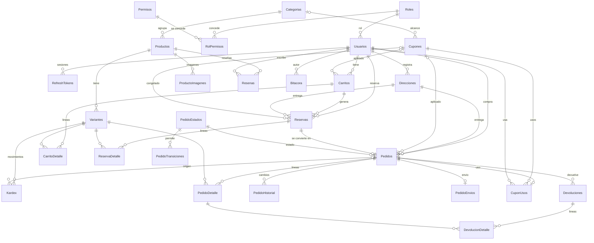

## Diagramas de estados

Pedido (las transiciones salen de `PedidoTransiciones`):

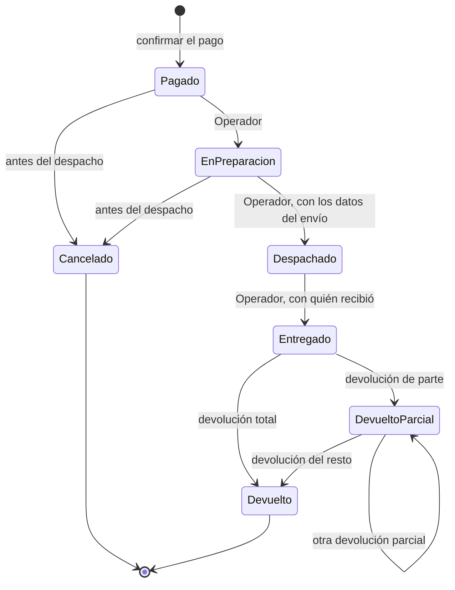

Despachar y entregar no agregan estados: guardan sus datos en `PedidoEnvios`, y `SP_Pedidos_CambiarEstado` rechaza con 52400 el cambio si faltan.

Reserva de existencia:

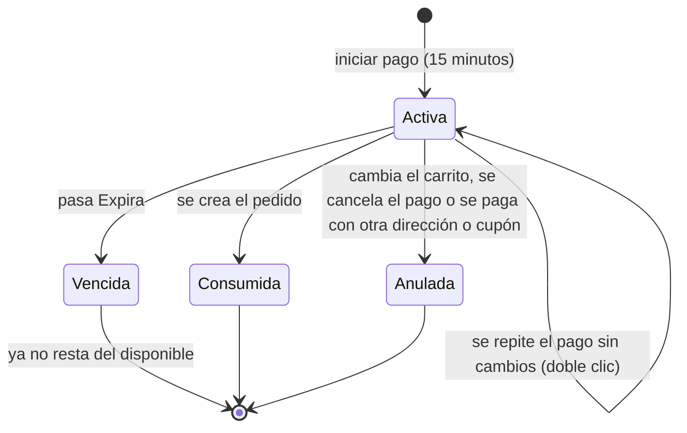

`Vencida` no es un valor guardado: es una reserva `Activa` con `Expira` en el pasado.

## Flujo de compra

1. `POST /api/publico/carrito/items` agrega productos (con sesión o con `X-Carrito-Token` de invitado).
2. `PUT /api/publico/carrito/cupon` aplica un cupón (con sesión).
3. `GET /api/cliente/direcciones` lista las direcciones del cliente; `POST /api/cliente/direcciones` registra una.
4. `POST /api/cliente/checkout/pagos` con `idDireccion` (o el texto de una dirección nueva) reserva la existencia 15 minutos.
5. `POST /api/cliente/checkout/reservas/{id}/pedido` confirma el pago simulado y crea el pedido.
6. El Operador avanza el pedido con `PATCH /api/admin/pedidos/{id}/estado`, con los datos del envío al despachar y quién recibió al entregar; las devoluciones se registran en `POST /api/admin/pedidos/{id}/devoluciones`. El Cliente cancela el suyo con `PATCH /api/cliente/pedidos/{id}/estado`.

## Estado de la verificación

La separación en dos servicios y los roles se verificaron con SQL Server 2022 en Docker (`mcr.microsoft.com/mssql/server:2022-latest`) y Node.js 24:

- `docker compose` sobre un volumen vacío crea la base desde `00_base`, aplica todos los scripts y `db-init` termina con código 0.
- `npx tsc --noEmit` sin errores, `npm run build` correcto y `npm test` con 77 pruebas aprobadas sobre una base recién creada, incluidas las de concurrencia.
- `database/pruebas/ejecutar.sh` con las cinco pruebas SQL aprobadas.
- `docker compose up --build` con los cuatro servicios, comprobado con curl: `/api/salud` identifica a cada uno, las rutas públicas responden 200, los dos logins funcionan, el login por el servicio equivocado y el cruce de tokens responden 401, las rutas del otro servicio responden 404, la verificación previa de CORS solo da permisos al origen propio y `/api/docs` documenta solo ese servicio.

No se volvió a probar en SQL Server LocalDB 2019.

### Fase 2

Verificado con SQL Server 2022 en Docker, Node.js 24 y Chromium sin interfaz (Playwright) contra la API real, sin datos simulados:

- En `web/`: `npm run typecheck` y `npm run build` sin errores.
- En `api/`: `npx tsc --noEmit` sin errores y `npm test` con 35 pruebas aprobadas sobre una base recién creada (Node.js 24). La API no se modificó.
- `docker compose up` con los cuatro servicios sobre un volumen vacío: `db-init` termina con código 0, la tienda responde en `http://127.0.0.1:8080`, las rutas de React (`/panel/dashboard`) devuelven `index.html` y `/api/salud` llega a la API a través de nginx.
- A 390 × 844, en el listado de productos: con la barra compacta se ven exactamente 6 tarjetas completas (3 filas de 2) entre la barra y el menú inferior, sin una séptima a medias. Al bajar, la barra pasa de 52 a 48 px y el buscador se oculta; al subir vuelve.
- Tienda: carrusel, categorías y secciones; agregar desde la tarjeta y desde el detalle con variantes; carrito de invitado que se conserva al iniciar sesión; cupón rechazado (`VENCIDO`, con el mensaje de la API) y aceptado (`Q50`); checkout con doble clic en confirmar y en pagar que crea un solo pedido; carrito vacío después de pagar.
- Renovación del token con la API configurada para que el token dure 3 segundos: dos peticiones simultáneas con el token vencido reciben 401, se hace un solo `/auth/refresh` y ambas se repiten con éxito; una segunda pestaña conserva la sesión.
- Mi cuenta: filtro por estado en la URL, detalle con historial, cancelación, CRUD de direcciones con validación y 404 al pedir el pedido de otro cliente.
- Operador: menú solo con pedidos e inventario y "Sin permiso" en el dashboard; un pedido avanzado de Pagado a Entregado, devolución parcial que lo deja en Devuelto en parte; salida mayor a la existencia rechazada con el mensaje de la API; entrada, salida y ajuste reflejados en el kardex.
- Administrador: dashboard con indicadores, 4 gráficas y carritos abandonados, y cambio de agrupación; alta de categoría, producto, variante, precio e imagen con sus validaciones; desactivación de producto; alta de cupón con validación de porcentaje y fechas; alta y desactivación de usuario; bitácora filtrada por módulo.
- Sin `VITE_MODO_DEMO` los botones de demostración no aparecen en el paquete compilado.
- Tras el rediseño visual se repitieron todas las pruebas de navegador anteriores con los mismos resultados, incluidas las 6 tarjetas exactas a 390 × 844 (la barra pasa de 56 a 48 px). Se revisaron capturas en celular y en computadora de inicio, listado, ficha de producto, carrito con productos y vacío, esqueleto de carga, login, checkout, pedidos, panel y dashboard.

No probado o con limitaciones del entorno de verificación:

- Las imágenes de muestra de `picsum.photos` no se pudieron descargar desde el entorno de prueba; en las capturas se reemplazaron por una imagen local. Hoy la tienda usa las fotos descritas en [Datos de muestra](#datos-de-muestra).
- La construcción de las imágenes de Docker se probó agregando el certificado del proxy de ese entorno en una copia temporal de los Dockerfile (el `npm ci` fallaba con `SELF_SIGNED_CERT_IN_CHAIN`). Los Dockerfile del repositorio no lo necesitan en una red normal.
- Solo Chromium; no se probó en Safari ni en Firefox, ni en teléfonos reales.
- `database/pruebas/ejecutar.sh` no se volvió a ejecutar en esta fase porque la base no cambió.

### Reseñas y productos relacionados

Verificado sobre una base recién creada, con SQL Server 2022 en Docker, Node.js 24 y Chrome sin interfaz (Playwright) a 390 × 844 contra la API real:

- En `api/`: `npx tsc --noEmit` sin errores y `npm test` con 48 pruebas aprobadas.
- `database/pruebas/ejecutar.sh` con las cinco pruebas SQL aprobadas (24 comprobaciones).
- En `web/`: `npx tsc --noEmit -p .` y `npm run build` sin errores.
- Detalle con reseñas de semilla, promedio y total; relacionados con la misma categoría primero; un cliente sin compra no ve el formulario; un cliente con pedido entregado publica su reseña y aparece primero; el segundo intento se rechaza con 409, por la API y desde una segunda pestaña; "Ver más" completa la lista.
- Estados de carga, vacío y error de reseñas con reintento; con los relacionados caídos la sección no aparece y el producto se puede comprar.
- Sin desborde horizontal, la barra de agregar no tapa el final de la página y siguen entrando 6 tarjetas completas en el inicio.

- Encabezado: en el inicio, bajar compacta y subir 60 px lo restaura lejos del tope; en el detalle no hay buscador, la barra se mantiene al bajar, "Volver" regresa o lleva al inicio sin historial, y no hay hueco arriba ni desborde. A 900 y 1280 px el carrito y los enlaces siguen accesibles.

No probado: Safari, Firefox y teléfonos reales.

### Dos servicios y dos aplicaciones web

Verificado con SQL Server 2022 en Docker, sobre una base recién creada. El frontend no tiene pruebas automáticas: se comprobó con tipos, compilación y peticiones HTTP reales por el puerto de cada contenedor, sin navegador.

- En `api/`: `npx tsc --noEmit` y `npm run build` sin errores, y `npm test` con 81 pruebas aprobadas.
- `database/pruebas/ejecutar.sh` con las cinco pruebas SQL aprobadas (31 comprobaciones).
- En `web/`: `npm run typecheck`, `npm run build` y `npm run build:admin` sin errores. Las 57 llamadas de `web/src` a rutas fijas coinciden con los dos archivos OpenAPI. El paquete de la tienda no contiene `/admin/auth` ni las pantallas del panel, y el del panel no contiene `/publico/auth` ni las de la tienda.
- `docker compose up --build` con los seis servicios: cada origen responde `index.html` y `/api/salud` con su servicio. Por la tienda entra un Cliente y por el panel el Administrador y el Operador; cruzar un login o un token responde 401. `/api/admin` por la tienda y `/api/publico` y `/api/cliente` por el panel responden 404. El carrito de invitado se fusiona al iniciar sesión y un refresh token reusado responde 401.

No probado: el recorrido en un navegador real después de la separación.
