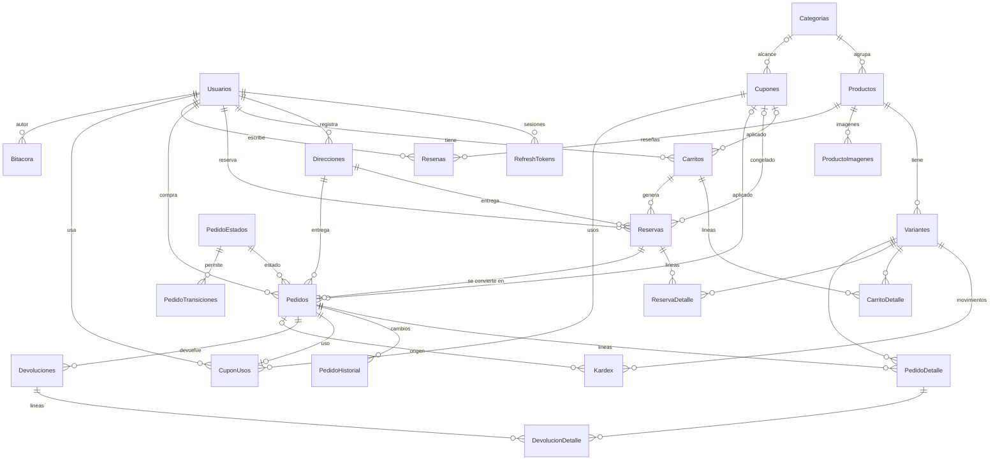
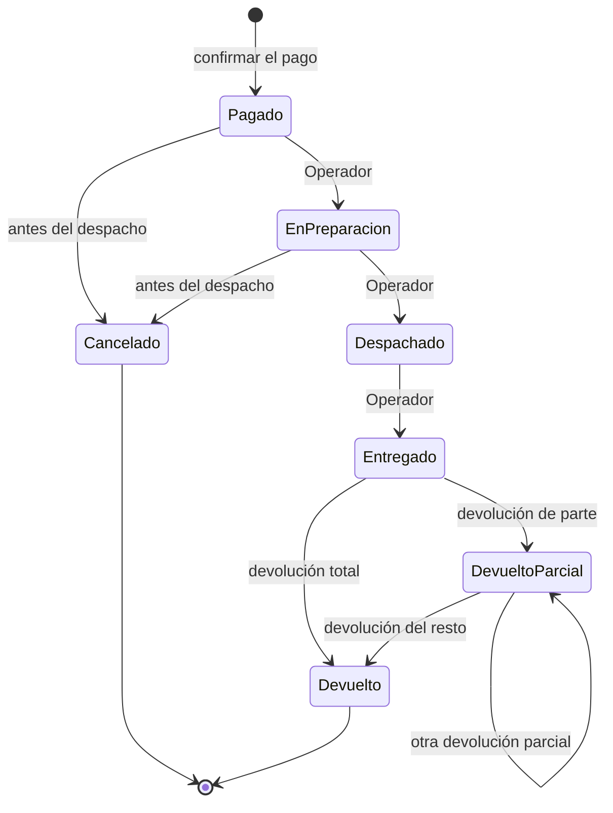
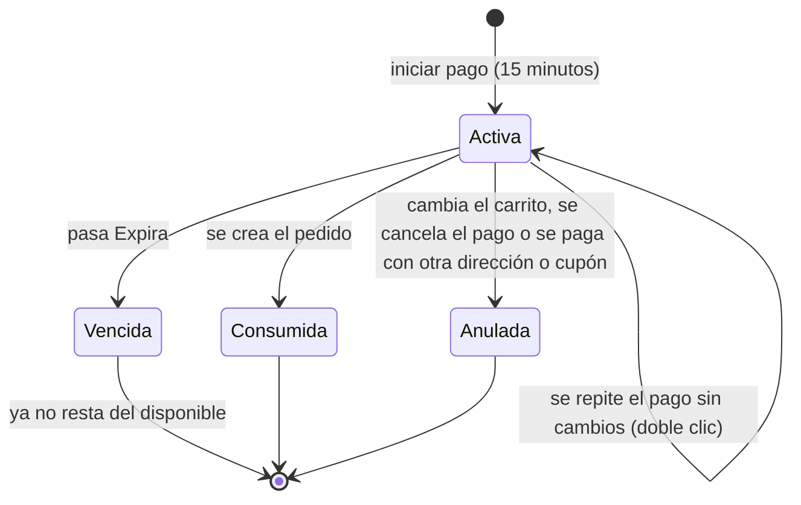

# ShopCart

Plataforma web de ventas con SQL Server, API en Express con TypeScript y frontend en React con TypeScript.
La especificación está en [docs/especificacion.md](docs/especificacion.md). La Fase 1 entregó la base de datos y la API; la Fase 2 agrega el frontend en `web/` y su servicio en Docker.

## Requisitos

- Docker con Docker Compose.
- Node.js 24 o superior, solo para desarrollar la API o el frontend fuera de Docker.

## Instalación

```bash
git clone https://github.com/eramirez150/shopcart.git
cd shopcart
cp .env.example .env
```

Editar `.env` y definir estos tres valores, sin comillas. Si falta alguno, `docker compose` se detiene con un error.

| Variable | Descripción |
| --- | --- |
| `MSSQL_SA_PASSWORD` | Clave de `sa`: mínimo 8 caracteres con mayúsculas, minúsculas, números y símbolos |
| `APP_DB_PASSWORD` | Clave de `shopcart_app`, con las mismas reglas |
| `JWT_SECRET` | Al menos 32 caracteres aleatorios |
| `VITE_MODO_DEMO` | Opcional. `true` muestra en el login los botones para entrar como cliente, operador o administrador. Por defecto `false` |
| `WEB_PORT` | Opcional. Puerto de la tienda en la máquina, útil si el `8080` está ocupado. Por defecto `8080` |

```bash
docker compose up --build
```

Se levantan cuatro servicios: `db`, `db-init` (aplica los scripts y termina), `api` y `web`. **La tienda queda en `http://127.0.0.1:8080`** (también `http://localhost:8080`); con `WEB_PORT` definido, en ese puerto. El servicio `web` sirve el frontend compilado con nginx y reenvía `/api` a la API, así que el navegador usa un solo origen. `VITE_MODO_DEMO` se fija al compilar: después de cambiarlo, ejecutar otra vez `docker compose up --build`. Para empezar con una base limpia: `docker compose down -v`.

La API queda en `http://localhost:3000/api` y su documentación en `http://localhost:3000/api/docs`. La base de datos queda disponible solo desde la propia máquina en `127.0.0.1,14335`. Los scripts de `database/` se aplican en orden: `00_base` crea la base, tablas y semillas se aplican una sola vez, y funciones, vistas, procedimientos y permisos en cada arranque.

### Usuario de la aplicación

La API no usa `sa`: usa `shopcart_app`, que solo tiene `EXECUTE` sobre los stored procedures por medio del rol `RolShopCartApp` (script `06_permisos/001_rol_aplicacion.sql`). `database/aplicar.sh` lo crea con la clave de `APP_DB_PASSWORD`.

### API fuera de Docker

```bash
cd api
npm install
```

Crear `api/.env` con estas variables (la API también las lee del entorno):

| Variable | Descripción | Por defecto |
| --- | --- | --- |
| `DB_HOST`, `DB_PORT`, `DB_NAME` | Dónde está la base | `127.0.0.1`, `14335`, `ShopCart` |
| `DB_USER`, `DB_PASSWORD` | Usuario de la aplicación (`shopcart_app`) | obligatorias |
| `JWT_SECRET` | Al menos 32 caracteres aleatorios. Generar con `node -e "console.log(require('crypto').randomBytes(48).toString('base64url'))"` | obligatoria |
| `JWT_ACCESS_MINUTES`, `JWT_REFRESH_DAYS` | Vida del token de acceso y del refresh token | `15`, `7` |
| `PORT`, `CORS_ORIGIN` | Puerto y orígenes permitidos separados por coma | `3000`, `http://localhost:5173` |

```bash
npm run dev      # desarrollo con recarga
npm run build && npm start
```

La documentación interactiva está en `http://localhost:3000/api/docs` (Swagger UI, con botón **Authorize** para pegar el JWT). El contrato escrito a mano es [api/openapi.yaml](api/openapi.yaml).

### Frontend fuera de Docker

Con la base y la API levantadas (por ejemplo `docker compose up -d db db-init api`):

```bash
cd web
npm install
npm run dev        # http://localhost:5173, con recarga
```

Vite reenvía `/api` a `http://localhost:3000`; otro destino se indica con `API_PROXY` en el entorno o en `web/.env`. Las variables del navegador están en `web/.env.example` (`VITE_API_URL`, por defecto `/api`, y `VITE_MODO_DEMO`).

```bash
npm run typecheck  # comprobación de tipos (tsc --noEmit, modo strict)
npm run build      # tipos y compilación a web/dist
```

Estructura de `web/src`:

```text
api/          Cliente de la API (token, renovación, errores), tipos de las respuestas y useApi
sesion/       Sesión del usuario y rutas protegidas por rol
componentes/  Estados de carga, vacío y error, paginación, campos, filtros en la URL, detalle de pedido
tienda/       Encabezado, inicio, búsqueda, detalle, carrito y checkout
cuenta/       Mi cuenta: pedidos y direcciones
panel/        Paneles de operador y administrador, dashboard
paginas/      Login y registro
App.tsx       Rutas
estilos.css   Estilos (un solo archivo, primero para celular)
```

### Pruebas

```bash
cd api
npm run typecheck
npm test
```

`seguridad.test.ts` no necesita base de datos. Los demás archivos (`flujo`, `concurrencia`, `direcciones`, `dashboard`, `catalogo`, `orden`, `reglas`, `resenas` y `relacionados`) exigen una base **recién creada** con todos los scripts y una conexión (`DB_USER` y `DB_PASSWORD`, o `TEST_DB_CONNECTION_STRING` con el controlador `msnodesqlv8` para SQL Server LocalDB). Sin conexión se omiten. Crean y modifican datos: usar una base de pruebas. Con Docker Compose, la base se recrea con `docker compose down -v` y `docker compose up -d db db-init`, y las pruebas se ejecutan desde `api/` con `DB_USER=shopcart_app` y `DB_PASSWORD` igual a `APP_DB_PASSWORD`.

Las pruebas que necesitan tocar la base directamente están en `database/pruebas/` (`aplicar.sh` no ejecuta esa carpeta) y se ejecutan con `sa`:

```bash
docker compose run --rm --entrypoint /bin/sh db-init /scripts/pruebas/ejecutar.sh
```

| Archivo | Qué comprueba |
| --- | --- |
| `permisos.sql` | `shopcart_app` solo puede ejecutar SP: no lee ni modifica tablas. |
| `bitacora.sql` | Ni siquiera `sa` puede modificar o borrar la bitácora (error 51403). |
| `resenas.sql` | `SP_Resenas_Crear` rechaza a quien no tiene un pedido `Entregado` con el producto, a otro rol y una segunda reseña, y la tabla rechaza una calificación fuera de 1 a 5. |
| `transiciones.sql` | El trigger rechaza un `UPDATE` directo con una transición que no está en `PedidoTransiciones`, y las devoluciones siguen funcionando. |
| `reserva_vencida.sql` | Una reserva vencida deja de restar del disponible, otro cliente puede reservar esa existencia, ya no se convierte en pedido y un pago nuevo la anula. Adelanta `Expira` con un `UPDATE` para no esperar 15 minutos. |

Cada archivo deshace sus cambios o crea datos con nombres únicos, y termina con error ante el primer fallo.

## Credenciales de prueba

Solo para desarrollo, creadas por los scripts de `database/02_semillas`. Cámbielas o elimínelas en cualquier entorno real.

| Rol | Correo | Contraseña |
| --- | --- | --- |
| Administrador | `admin@shopcart.test` | `Admin123!` |
| Operador | `operador@shopcart.test` | `Operador123!` |
| Cliente | `cliente@shopcart.test` | `Cliente123!` |
| Cliente | `cliente2@shopcart.test` | `Cliente123!` |

Cupones de ejemplo: `BIENVENIDA10` (10 %, una vez por cliente), `Q50` (Q50 con compra mínima de Q300), `ELECTRO15` (15 % solo en Electrónica), `LIMITADO5` (5 usos en total), `VENCIDO` e `INACTIVO` (para ver los rechazos).

Datos de demostración (`02_semillas/002_demostracion.sql`), para que el dashboard no salga vacío: direcciones de los dos clientes, 14 pedidos de los últimos 75 días en todos los estados (con devoluciones parciales y totales y una cancelación) y 3 carritos abandonados (uno de `cliente2@shopcart.test` y dos de invitados). Ningún pedido es de hoy ni de ayer.

Reseñas de prueba (`02_semillas/003_resenas.sql`): 34 reseñas inventadas en 12 productos con foto. **Son datos de prueba**: sus autores son 6 clientes desactivados (`resena1@shopcart.test` a `resena6@shopcart.test`), sin contraseña válida y sin pedidos, así que esas reseñas se escribieron directamente y no provienen de una compra real. Las reseñas creadas desde la tienda sí exigen un pedido `Entregado`.

## Datos de muestra

30 de los 50 productos muestran una foto de referencia; los otros 20 muestran la silueta de su categoría, para no enseñar una foto que no es suya. `001_semillas.sql` inserta una imagen de `picsum.photos` por producto y `002_fotos_reales.sql` la cambia por la foto elegida o la quita.

- Las fotos son referencias de demostración, alojadas por la tienda de origen (`m.media-amazon.com`). No son del proyecto, no se descargan ni se guardan en el repositorio. La tienda necesita internet para mostrarlas.
- Los nombres y las descripciones de los productos son propios: de la búsqueda solo se guarda la dirección de la imagen.
- `scraper/fotos-amazon.mjs` visitó una vez, con un Chrome normal, 30 páginas públicas de búsqueda, una por producto y una a la vez, con 4 a 8 segundos de pausa, sin cuenta y sin proxies. No evade CAPTCHA: si aparece uno o un bloqueo, la corrida termina con lo capturado y no reintenta.
- `scraper/fotos.json` guarda las candidatas de cada búsqueda y, en `imagen`, la elegida al revisarlas a mano. El comando `capturar` se niega a correr si ese archivo existe; para cambiar una foto se edita el archivo y se regenera la semilla sin visitar ningún sitio:

```sh
cd scraper
npm install
npm run semilla
```

## Scripts de base de datos

Cada objeto vive en su propio archivo y el archivo se llama como el objeto (`SP_Pedidos_Listar.sql`). `aplicar.sh` recorre las carpetas en orden numérico y, dentro de cada una, los archivos en orden alfabético.

```text
database/
  00_base/            Crea la base (001_crear_base.sql) y el registro de scripts (002_scripts_aplicados.sql)
  01_tablas/          Tablas, índices y triggers por módulo (001_usuarios, 002_catalogo, ...)
  02_semillas/        001: usuarios por rol, categorías, 50 productos con imagen, kardex y cupones
                      002_demostracion: direcciones, pedidos, devoluciones y carritos abandonados de demostración
                      002_fotos_reales: fotos de referencia de 30 productos, generado desde scraper/fotos.json
                      003_resenas: reseñas de prueba de 12 productos y sus autores
  03_funciones/       FU_Modulo_Proceso.sql
  04_vistas/          VW_Modulo_Proceso.sql
  05_procedimientos/  Una subcarpeta por módulo, con SP_Modulo_Proceso.sql
  06_permisos/        Rol de aplicación con solo EXECUTE
  pruebas/            Pruebas SQL y su ejecutor (ejecutar.sh); aplicar.sh no las ejecuta
  aplicar.sh
```

| Carpeta | Cómo se aplica |
| --- | --- |
| `00_base` | En cada ejecución y fuera de transacción (`CREATE DATABASE` no se permite dentro de una). `001_crear_base.sql` se ejecuta en `master` con la variable de sqlcmd `DB_NAME`; si la base o la tabla ya existen no hace nada. |
| `01_tablas`, `02_semillas` | Una sola vez. Cada archivo se registra en `dbo.ScriptsAplicados` con su ruta relativa. |
| `03_funciones` a `06_permisos` | En cada ejecución, con `CREATE OR ALTER`. No se registran: un cambio en un SP llega a una base que ya existe. |

- Cada archivo se ejecuta en su propia transacción (en `01` y `02`, junto con su registro). Si algo falla, no queda nada a medias y el contenedor `db-init` termina con error.
- Un archivo no abre ni confirma transacciones propias.
- Las tablas no se pueden reaplicar: un cambio en una tabla ya creada exige un archivo nuevo en `01_tablas` (por ejemplo `010_cambio.sql` con `ALTER TABLE`), nunca editar el existente. Excepción de esta entrega: como todavía no hay ninguna base entregada, las correcciones de la Fase 1 editaron `01_tablas` y `02_semillas` directamente; una base creada antes de estas correcciones se debe recrear (`docker compose down -v`).
- Para crear la base sin Docker: ejecutar `00_base/001_crear_base.sql` en `master` (`sqlcmd -v DB_NAME=ShopCart`; en SSMS, modo SQLCMD con `:setvar DB_NAME ShopCart`) y luego los demás archivos en el orden descrito.
- Si una vista o función depende de otra, se les pone un prefijo numérico para que se creen en orden. Hoy ninguna lo necesita.

### Agregar un procedimiento

1. Crear `database/05_procedimientos/<Modulo>/SP_<Modulo>_<Proceso>.sql` con una sola instrucción `CREATE OR ALTER PROCEDURE dbo.SP_<Modulo>_<Proceso>` y `GO` al final.
2. Poner encima un comentario breve que explique qué hace.
3. Ejecutar `docker compose up db-init`: el archivo nuevo se aplica y los demás se reaplican sin cambios.

Una función se agrega igual en `03_funciones` y una vista en `04_vistas`. El módulo es la carpeta; los errores se lanzan con `THROW 52000 + código HTTP`.

### Vistas de control

Son de solo lectura, sirven para revisar desde SSMS y la API no las usa.

| Vista | Qué muestra |
| --- | --- |
| `VW_Inventario_Control` | Una fila por variante: existencia, reservado, disponible y la diferencia con la suma del kardex, que debe ser 0. |
| `VW_Pedidos_Resumen` | Una fila por pedido: cliente, estado, líneas, unidades, devoluciones, totales y cupón. |

```sql
SELECT * FROM dbo.VW_Inventario_Control WHERE DiferenciaKardex <> 0;
SELECT * FROM dbo.VW_Pedidos_Resumen ORDER BY FechaCreacion DESC;
```

### Reglas por módulo

- Un pedido completado es `Entregado` o `DevueltoParcial`; las ventas del dashboard son netas de devoluciones.
- Ticket promedio = monto total vendido ÷ número de pedidos pagados del periodo, como lo define el glosario. Un pedido pagado es cualquiera menos `Cancelado`; el monto vendido es la suma de su `Total` (lo cobrado, sin restar devoluciones). El resto del dashboard usa ventas netas.
- Carrito abandonado: abierto, con productos y sin cambios en las últimas 24 horas. Las 24 horas son el valor por defecto del parámetro `horas` de `/dashboard/indicadores` y `/dashboard/carritos-abandonados`.
- Cualquier cambio en el carrito anula su reserva activa: el cliente debe iniciar el pago otra vez. Repetir el inicio del pago **sin** cambios devuelve la misma reserva (doble clic).
- Direcciones: cada usuario registra, lista, modifica y desactiva las suyas en `/api/direcciones`; la de otro usuario responde 404 en la API y en los SP. Al pagar se elige una con `idDireccion` o se envía el texto de una nueva, que queda registrada (si ya existe una idéntica se reutiliza). Reservas y pedidos guardan `IDDireccion` y copian el texto, así modificar o desactivar la dirección después no altera un pedido.
- Las devoluciones solo las registra un Operador o un Administrador (`POST /api/pedidos/{id}/devoluciones`); el Cliente consulta las de sus pedidos.
- Las escrituras del catálogo exigen rol Administrador y nada con ventas o movimientos se elimina: se desactiva. Las variantes y los cupones no tienen ruta para borrar: se desactivan con `activa: false` (`PUT /api/productos/variantes/{id}`) y `activo: false` (`PUT /api/cupones/{id}`), porque los referencian carritos, reservas, pedidos y usos.
- Reseñas: solo un Cliente con un pedido `Entregado` que contenga una variante del producto, una por usuario y producto (`UQ_Resenas_Producto_Usuario`). Sin compra responde 403 con `RESENA_SIN_COMPRA` y repetida 409 con `RESENA_DUPLICADA`; `GET /api/productos/{id}/resenas/permiso` lo indica antes de mostrar el formulario. El listado es público y muestra el nombre y la inicial del apellido (`FU_Resenas_Publicas`), nunca el correo ni el id del usuario. Si el nombre registrado es un correo, se muestra "Cliente". Una reseña no se edita ni se borra, y se conserva aunque el pedido se devuelva después.
- Los atributos de una variante se guardan como un objeto JSON en texto (`{"Talla":"M","Color":"Azul"}`), validado con `ISJSON`; la API los recibe y devuelve como objeto. Así cada categoría define sus propios atributos sin tablas adicionales.
- Imágenes: cada producto tiene cero o más imágenes (`ProductoImagenes`) con URL http(s), texto alternativo y orden; la de menor orden es la principal y aparece en la búsqueda. Se guardan solo las URL: el archivo vive fuera de la base. Quitar una imagen la elimina, porque no tiene ventas ni movimientos.
- Relacionados: `GET /api/productos/{id}/relacionados` devuelve hasta 12 productos con la forma del listado: primero los de la misma categoría y luego otros, en orden aleatorio. Solo muestra lo que muestra la búsqueda pública y omite el producto actual.
- Catálogo de administración: `GET /api/productos/administracion` lista también productos inactivos, de categorías inactivas y sin variantes. La búsqueda pública solo muestra productos activos con variantes activas.
- Los listados de pedidos, usuarios, cupones, kardex, existencias, bitácora y catálogo aceptan `orden`; el SP valida el valor y ordena con `CASE`, sin SQL dinámico.
- Una salida o un ajuste manual no puede dejar la existencia por debajo de lo reservado por pagos en curso: responde 409 e indica cuánto se puede retirar.
- El hash de la contraseña lo calcula la API (bcrypt); del refresh token solo se guarda su SHA-256.
- Los errores usan `THROW` con `52000` más el código HTTP: `52400` datos inválidos, `52401` no autenticado, `52403` sin permiso, `52404` no existe y `52409` conflicto con el estado actual.

## Decisiones técnicas

| Riesgo | Decisión |
| --- | --- |
| Sobreventa | `SP_Checkout_IniciarPago` bloquea las variantes con `UPDLOCK, HOLDLOCK` en orden de `IDVariante` y compara contra el disponible. Una prueba lanza 25 compras simultáneas de 4 unidades y exactamente 4 pasan. |
| Reserva vencida | Disponible = existencia − reservas `Activa` con `Expira` futura (`FU_Inventario_Disponibilidad`). Sin proceso programado. Iniciar el pago otra vez anula la reserva anterior si está vencida o si cambió la dirección o el cupón. |
| Doble clic en pagar | `SP_Checkout_IniciarPago` bloquea el carrito; si ya tiene una reserva activa, no vencida, con la misma dirección y el mismo cupón, la devuelve sin anularla. Como todo cambio del carrito anula su reserva, una reserva activa implica un carrito sin cambios. Una prueba lanza 10 inicios de pago simultáneos y todos reciben la misma reserva. |
| Reservado y ajustes | `SP_Inventario_Registrar` bloquea la variante igual que el checkout y rechaza una salida o ajuste que deje la existencia por debajo de lo reservado. |
| Precio congelado | `ReservaDetalle` guarda precio y descuento; `PedidoDetalle` los copia. |
| Pedido duplicado | `Pedidos.IDReserva` es `UNIQUE` y la fila de la reserva se bloquea: un reintento espera y devuelve el mismo pedido. |
| Cupón concurrente | `UPDATE Cupones SET Usos = Usos + 1 WHERE Usos < LimiteTotal` y revisión de `@@ROWCOUNT`; la misma transacción revisa el límite por cliente. |
| Descuento exacto | El descuento total se calcula una vez y se reparte por líneas con diferencias de sumas acumuladas redondeadas: las líneas suman exactamente el total y nunca superan su valor. |
| Datos de otro cliente | `@IDUsuario` sale del JWT. Los SP que reciben `@IDUsuario` (carrito, direcciones, checkout, pedidos, devoluciones, cupones, usuarios, reportes, bitácora, escrituras de reseñas y escrituras del catálogo y del inventario) vuelven a verificar el rol y la propiedad. Los SP de lectura de inventario (`SP_Inventario_ListarExistencias`, `SP_Inventario_ConsultarKardex`) y de catálogo (`SP_Catalogo_BuscarProductos`, `SP_Catalogo_ObtenerProducto`, `SP_Catalogo_ObtenerRelacionados`, `SP_Categorias_Listar`) no reciben usuario: el catálogo es público y el inventario depende de que la API exija rol Operador o Administrador. |
| Estados | Tabla `PedidoTransiciones`, validada en el servicio, en `SP_Pedidos_CambiarEstado` y en el trigger `TR_Pedidos_ValidarTransicion` (AFTER UPDATE), que rechaza con 52409 cualquier cambio de estado fuera de la tabla aunque no pase por los SP. |
| Existencia | Solo `SP_Inventario_RegistrarMovimiento` la cambia, junto con su fila de kardex en la misma transacción. |
| Bitácora | Triggers sobre productos, variantes, cupones y estado de pedidos, más un trigger `INSTEAD OF UPDATE, DELETE` que la hace inmutable. El SP guarda el usuario con `sp_set_session_context`. |
| Permisos | Rol `RolShopCartApp` con `EXECUTE` y nada más. Se verifica en `database/pruebas/permisos.sql`. |
| Errores | Los SP lanzan `THROW 52000 + código HTTP` (`52409` es 409). La API lo traduce en un solo lugar. |
| Sesiones | Access token de 15 minutos (token expirado: 401). Refresh token aleatorio de un solo uso: en la base solo se guarda su SHA-256; reusar uno revocado cierra todas las sesiones del usuario. Contraseñas con bcrypt (costo 10). |
| Venta neta | Un pedido completado es `Entregado` o `DevueltoParcial`. El dashboard descuenta las devoluciones y las fechas filtran por la del pedido. El ticket promedio es la excepción: monto vendido entre pedidos pagados, según el glosario. |
| Pago | Simulado: confirmar el pago crea el pedido con una referencia única. |

Limitaciones conocidas: un usuario desactivado conserva su token de acceso hasta que vence (15 minutos) y no puede renovarlo ni pagar, aunque puede seguir modificando su carrito durante ese tiempo; no hay límite de intentos de inicio de sesión.

## Decisiones del frontend

| Tema | Decisión |
| --- | --- |
| Sesión | El access token y el refresh token se guardan en `localStorage` para sobrevivir a una recarga. Es lo más simple de explicar; el costo es que un script inyectado podría leerlos (no hay HTML de usuarios sin escapar: React escapa todo el texto). |
| Renovación del token | Ante un 401, `api/cliente.ts` pide `/auth/refresh` y repite la petición una sola vez. Como el refresh token es de un solo uso y reusarlo cierra todas las sesiones, las peticiones simultáneas comparten la misma renovación y las pestañas se coordinan con Web Locks: si otra pestaña ya renovó, se usa su sesión. |
| Carrito de invitado | El token del carrito se guarda en `localStorage` y viaja en `X-Carrito-Token`. Al iniciar sesión se envía para que la API lo fusione y luego se borra. `/auth/registro` no fusiona carritos, así que el registro cierra la sesión que abre y entra con `/auth/login`, que sí lo hace. |
| Un solo origen | El frontend llama a `/api` relativo: Vite (desarrollo) y nginx (Docker) lo reenvían a la API. No depende de CORS; aun así `CORS_ORIGIN` admite `localhost` y `127.0.0.1` en el puerto 8080. |
| Rutas por rol | `RutaProtegida` exige sesión y rol. El cliente usa la tienda, el checkout y Mi cuenta; operador y administrador entran a `/panel`, cuyo menú lateral muestra solo lo de su rol. La API vuelve a validar todo. |
| Filtros | Los filtros, el orden y la página de cada listado viven en la URL (`?estado=Pagado&pagina=2`): se pueden recargar y compartir, y el botón Atrás funciona. El filtrado, el orden y la paginación los hace la API. |
| Formularios | Validación propia en `validacion.ts`, sin librería. Los errores de validación que devuelve la API (`detalle`) se muestran junto al campo y los demás errores, con su mensaje, encima del botón. |
| Doble envío | Los botones que escriben se deshabilitan mientras esperan. En el checkout además hay un bloqueo inmediato con `useRef`, porque el estado de React tarda un render; la API ya devuelve la misma reserva y el mismo pedido si se repite la petición. |
| Seis productos por pantalla | En celular la cuadrícula tiene dos columnas y cada fila mide un tercio del alto útil (`100dvh` menos la barra compacta, el menú inferior y los espacios). Así entran exactamente 3 filas entre la barra y el menú en 390 × 844 y en cualquier alto. Desde 600 px las tarjetas son cuadradas y hay 3 o más columnas. |
| Datos que la API no tiene | El listado no entrega calificaciones, ventas por producto ni precio anterior. La tarjeta solo muestra estrellas, ventas y precio tachado si esos campos llegan (`Calificacion`, `Ventas`, `PrecioAnterior`); hoy esas líneas se omiten. Las estrellas de las tarjetas quedan fuera del alcance de las reseñas, que solo se ven en el detalle. Tampoco hay un listado público de los más vendidos (`/dashboard/top-productos` es solo para el administrador), así que las secciones del inicio son Novedades, Precios bajos y dos categorías. |
| Promociones | No hay módulo de promociones: el carrusel invita a recorrer las cuatro primeras categorías reales, sin descuentos inventados. "Ver ofertas" lleva a los productos ordenados por precio. |
| Reseñas y relacionados | El detalle muestra debajo de la descripción el promedio, la lista con "Ver más" de 5 en 5 y el formulario, que aparece solo si `/resenas/permiso` confirma que el cliente puede reseñar. Las estrellas usan el acento rojo sobre gris plata. Los relacionados reutilizan la tarjeta y la cuadrícula; si fallan o no hay, la sección no aparece y el resto de la página sigue funcionando. |
| Carrito | Las líneas del carrito no traen imagen ni producto (solo variante), por eso se muestran sin foto. El cupón exige sesión, como la API. |
| Checkout | Se permite solo al rol Cliente. Pasos: dirección (guardada o nueva), cupón (el del carrito), confirmación, que reserva la existencia 15 minutos, y pago simulado, que crea el pedido. Un 409 al pagar (reserva vencida o carrito cambiado) regresa a la confirmación con el mensaje de la API. |
| Confirmaciones | Desactivar o eliminar usa `window.confirm`; cancelar un pedido tiene una confirmación en la página. |
| Gráficas | Chart.js con una sola serie por gráfica en el color de acento, sin doble eje (ventas y pedidos van en gráficas separadas) y con una tabla equivalente debajo. Se carga solo al abrir el dashboard (`React.lazy`), así la tienda no la descarga. |
| Identidad visual | Una sola familia tipográfica, Bricolage Grotesque, con eje óptico: titulares gruesos y apretados, y texto pequeño abierto. Fondo papel cálido (`#f6f3ed`), tinta casi negra y un único acento verde pino (`#1d5c47`) en el encabezado, los botones principales y los estados activos. Las superficies se separan por tono, sin bordes ni sombras; solo las filas de tablas y listas llevan una línea tenue porque ayuda a leer. Los estados de pedidos y productos se escriben como texto, sin pastillas de colores. |
| Productos y precios | La foto ocupa casi toda la tarjeta y el precio es el texto más grueso de cada vista. `componentes/Precio.tsx` reduce la "Q" y los centavos para que el entero domine, con cifras tabulares para que los montos se alineen. |
| Movimiento | Curvas propias (`--curva`, `--curva-rebote`) y dos duraciones (160 y 280 ms). Las vistas aparecen con opacidad y los bloques suben 10 px en cascada. Otros detalles: el botón redondo late mientras agrega y muestra una marca al terminar, el contador del carrito salta al cambiar, la sección activa del menú inferior se marca con una raya que crece y el encabezado se reduce al bajar. La vista completa solo cambia de opacidad, porque un `transform` en ella movería las barras fijas. Con `prefers-reduced-motion` se desactiva todo. |
| Carga y vacíos | En lugar de un indicador giratorio, cada vista muestra un esqueleto con la forma del contenido real (cuadrícula, filas o ficha de producto), así la página no salta al llegar los datos. Cada estado vacío y de error tiene una ilustración propia (`componentes/Ilustraciones.tsx`), un titular y, cuando hay algo que hacer, una sola acción. |
| Accesos de demostración | Con `VITE_MODO_DEMO=true` el login muestra tres botones con las credenciales de prueba. Sin esa variable el código no llega al paquete compilado. |

## Supuestos

El enunciado no define estos puntos, así que se decidieron de esta forma:

- Un pedido completado es `Entregado` o `DevueltoParcial`.
- Cancelar devuelve el uso del cupón; una devolución no lo devuelve.
- Modificar el carrito anula la reserva activa.
- Se puede armar el carrito como invitado, pero pagar exige iniciar sesión.
- Un pedido usa como máximo un cupón.
- Para reseñar cuenta solo un pedido `Entregado`: uno `DevueltoParcial` o `Devuelto` ya no habilita una reseña nueva.
- Un pedido pagado es cualquier pedido que no esté `Cancelado` (el pago simulado ocurre al crearlo); el ticket promedio usa su total cobrado.
- Se puede pagar con una dirección nueva sin registrarla antes: queda guardada en las direcciones del cliente.
- Las imágenes son URL externas; subir archivos queda fuera de la Fase 1.
- Los precios publicados incluyen IVA del 12 %: el IVA del pedido se calcula a partir del total y no se suma.
- El pago es simulado porque el enunciado no exige pasarela.

## Librerías

Todas respetan el stack obligatorio. Ninguna accede a datos por su cuenta: `mssql` solo ejecuta stored procedures.

| Librería | Para qué se usa | Por qué |
| --- | --- | --- |
| `express` | Servidor HTTP y rutas | Exigida por el stack |
| `mssql` | Ejecutar stored procedures con parámetros tipados | Controlador de SQL Server para Node.js; no es un ORM |
| `zod` | Validar los datos de entrada | Los esquemas son breves y dan tipos de TypeScript |
| `jsonwebtoken` | Firmar y verificar los tokens de acceso | Implementación estándar de JWT |
| `bcryptjs` | Guardar el hash de las contraseñas | Escrita en JavaScript: no necesita compilar código nativo en Docker |
| `helmet` | Cabeceras de seguridad | Las configura en un solo lugar |
| `cors` | Definir los orígenes permitidos | Middleware habitual de Express |
| `swagger-ui-express` | Publicar la documentación en `/api/docs` | Muestra `openapi.yaml` y su botón para autorizar con JWT |
| `yaml` | Leer `openapi.yaml` al iniciar | Node.js no lee YAML por sí solo |

Solo para desarrollo: `typescript` compila el código, `tsx` ejecuta TypeScript en modo de desarrollo y en las pruebas, y los paquetes `@types/*` aportan los tipos de las librerías.

### Frontend (`web/`)

| Librería | Para qué se usa | Por qué |
| --- | --- | --- |
| `react`, `react-dom` | Interfaz | Exigida por el stack |
| `react-router` | Rutas, rutas protegidas y parámetros de la URL | Exigida por el enunciado; es la librería de rutas habitual de React |
| `@fontsource-variable/bricolage-grotesque` | Tipografía de la identidad visual | Incluye el archivo de la fuente en el paquete: se sirve desde el propio sitio, sin pedirla a un servicio externo. Solo se descarga el subconjunto latino (unos 77 kB) |
| `chart.js` | Gráficas de barras del dashboard | Una sola librería de gráficas, sin dependencias, con tooltip y accesible por `aria-label`. Se registran solo las piezas que se usan y se descarga solo en el dashboard |

Solo para desarrollo: `vite` y `@vitejs/plugin-react` sirven y compilan el proyecto, `typescript` comprueba los tipos y `@types/react` y `@types/react-dom` aportan los tipos de React. No se usan librerías de estado, formularios, peticiones ni componentes visuales: `fetch`, los contextos de React y un archivo de estilos alcanzan.

### Scraper (`scraper/`)

| Librería | Para qué se usa | Por qué |
| --- | --- | --- |
| `playwright-core` | Abrir las páginas de búsqueda en el Chrome instalado | Los resultados se arman en el navegador. No descarga navegadores propios y no forma parte de la API ni del frontend: solo se usó para generar `fotos.json` |

## Modelo entidad-relación



## Diagramas de estados

Pedido (las transiciones salen de `PedidoTransiciones`):



Reserva de existencia:



`Vencida` no es un valor guardado: es una reserva `Activa` con `Expira` en el pasado.

## Flujo de compra

1. `POST /api/carrito/items` agrega productos (con sesión o con `X-Carrito-Token` de invitado).
2. `PUT /api/carrito/cupon` aplica un cupón.
3. `GET /api/direcciones` lista las direcciones del cliente; `POST /api/direcciones` registra una.
4. `POST /api/checkout/pagos` con `idDireccion` (o el texto de una dirección nueva) reserva la existencia 15 minutos.
5. `POST /api/checkout/reservas/{id}/pedido` confirma el pago simulado y crea el pedido.
6. El Operador avanza el pedido con `PATCH /api/pedidos/{id}/estado`; las devoluciones se registran en `POST /api/pedidos/{id}/devoluciones`.

## Estado de la verificación

Las correcciones de la Fase 1 se verificaron con SQL Server 2022 en Docker (`mcr.microsoft.com/mssql/server:2022-latest`) y Node.js 22:

- `docker compose up db db-init` sobre un volumen vacío crea la base desde `00_base`, aplica todos los scripts y termina con código 0; una segunda ejecución omite tablas y semillas y también termina con código 0.
- `npx tsc --noEmit` sin errores y `npm test` con 36 pruebas aprobadas sobre una base recién creada.
- `database/pruebas/ejecutar.sh` con las cuatro pruebas SQL aprobadas.
- `VW_Inventario_Control` sin diferencias entre la existencia y el kardex después de las semillas.
- `docker compose up` con los tres servicios: `db-init` termina con código 0 y la API (imagen `node:24-alpine`) responde en `/api/salud`, `/api/docs` y el dashboard con los datos de demostración.

`npm test` se ejecutó con Node.js 22; la API en Node.js 24 solo se probó dentro de Docker. No se volvió a probar en SQL Server LocalDB 2019.

### Fase 2

Verificado con SQL Server 2022 en Docker, Node.js 24 y Chromium sin interfaz (Playwright) contra la API real, sin datos simulados:

- En `web/`: `npm run typecheck` y `npm run build` sin errores.
- En `api/`: `npx tsc --noEmit` sin errores y `npm test` con 35 pruebas aprobadas sobre una base recién creada (Node.js 24). La API no se modificó.
- `docker compose up` con los cuatro servicios sobre un volumen vacío: `db-init` termina con código 0, la tienda responde en `http://127.0.0.1:8080`, las rutas de React (`/panel/dashboard`) devuelven `index.html` y `/api/salud` llega a la API a través de nginx.
- A 390 × 844, en el listado de productos: con la barra compacta se ven exactamente 6 tarjetas completas (3 filas de 2) entre la barra y el menú inferior, sin una séptima a medias. Al bajar, la barra pasa de 52 a 48 px y el buscador se oculta; al subir vuelve.
- Tienda: carrusel, categorías y secciones; agregar desde la tarjeta y desde el detalle con variantes; carrito de invitado que se conserva al iniciar sesión; cupón rechazado (`VENCIDO`, con el mensaje de la API) y aceptado (`Q50`); checkout con doble clic en confirmar y en pagar que crea un solo pedido; carrito vacío después de pagar.
- Renovación del token con la API configurada para que el token dure 3 segundos: dos peticiones simultáneas con el token vencido reciben 401, se hace un solo `/auth/refresh` y ambas se repiten con éxito; una segunda pestaña conserva la sesión.
- Mi cuenta: filtro por estado en la URL, detalle con historial, cancelación, CRUD de direcciones con validación y 404 al pedir el pedido de otro cliente.
- Operador: menú solo con pedidos e inventario y "Sin permiso" en el dashboard; un pedido avanzado de Pagado a Entregado, devolución parcial que lo deja en Devuelto en parte; salida mayor a la existencia rechazada con el mensaje de la API; entrada, salida y ajuste reflejados en el kardex.
- Administrador: dashboard con indicadores, 4 gráficas y carritos abandonados, y cambio de agrupación; alta de categoría, producto, variante, precio e imagen con sus validaciones; desactivación de producto; alta de cupón con validación de porcentaje y fechas; alta y desactivación de usuario; bitácora filtrada por módulo.
- Sin `VITE_MODO_DEMO` los botones de demostración no aparecen en el paquete compilado.
- Tras el rediseño visual se repitieron todas las pruebas de navegador anteriores con los mismos resultados, incluidas las 6 tarjetas exactas a 390 × 844 (la barra pasa de 56 a 48 px). Se revisaron capturas en celular y en computadora de inicio, listado, ficha de producto, carrito con productos y vacío, esqueleto de carga, login, checkout, pedidos, panel y dashboard.

No probado o con limitaciones del entorno de verificación:

- Las imágenes de muestra de `picsum.photos` no se pudieron descargar desde el entorno de prueba; en las capturas se reemplazaron por una imagen local. Hoy la tienda usa las fotos descritas en [Datos de muestra](#datos-de-muestra).
- La construcción de las imágenes de Docker se probó agregando el certificado del proxy de ese entorno en una copia temporal de los Dockerfile (el `npm ci` fallaba con `SELF_SIGNED_CERT_IN_CHAIN`). Los Dockerfile del repositorio no lo necesitan en una red normal.
- Solo Chromium; no se probó en Safari ni en Firefox, ni en teléfonos reales.
- `database/pruebas/ejecutar.sh` no se volvió a ejecutar en esta fase porque la base no cambió.

### Reseñas y productos relacionados

Verificado sobre una base recién creada, con SQL Server 2022 en Docker, Node.js 24 y Chrome sin interfaz (Playwright) a 390 × 844 contra la API real:

- En `api/`: `npx tsc --noEmit` sin errores y `npm test` con 48 pruebas aprobadas.
- `database/pruebas/ejecutar.sh` con las cinco pruebas SQL aprobadas (22 comprobaciones).
- En `web/`: `npx tsc --noEmit -p .` y `npm run build` sin errores.
- Detalle con reseñas de semilla, promedio y total; relacionados con la misma categoría primero; un cliente sin compra no ve el formulario; un cliente con pedido entregado publica su reseña y aparece primero; el segundo intento se rechaza con 409, por la API y desde una segunda pestaña; "Ver más" completa la lista.
- Estados de carga, vacío y error de reseñas con reintento; con los relacionados caídos la sección no aparece y el producto se puede comprar.
- Sin desborde horizontal, la barra de agregar no tapa el final de la página y siguen entrando 6 tarjetas completas en el inicio.

No probado: Safari, Firefox y teléfonos reales.
